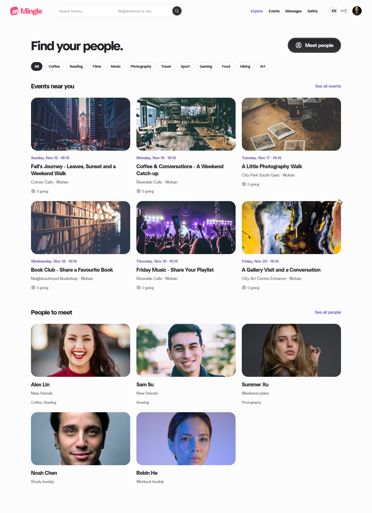

# Mingle: An Interest-Based Friendship Website

Mingle is a six-person Thematic Project built with **Java 21, Spring Boot and Thymeleaf**. Discover people and local activities, connect through shared interests, and keep conversations in the same browser application. Events, attendance, saved activities and messages persist in H2.

**Qin Tian (A) is Scrum Master and Lead Developer, and the primary technical contributor. Tao Jiacheng (C) is Product Owner.** Both participated in topic selection. A owns the AI-assisted baseline, core discovery, shared UI, activity flow, integration and release verification. The [contribution record](team-plan/15_contribution_and_ownership.md) preserves each member's actual work and separates completed increments from future assignments.



## Run the website

Open [code/thematic-friend](code/thematic-friend/) as a Maven project, select JDK 21 and run `ThematicFriendApplication`. Open **http://127.0.0.1:8080/**. Java, HTML, CSS and JavaScript are in one project; no Node.js build is required for the website.

For the optional fictional profiles, activities and conversation fixtures, run from the Java project:

```powershell
.\scripts\run-demo.ps1 -SeedConversations
```

The helper requests a local demo password and preserves the selected database. Sign in as `demo_zhou` and `demo_lin` in separate normal/private browser windows to exchange real persisted messages. Existing accounts retain their original passwords. The opt-in library contains 28 profiles, 18 activities and three starter connections; prior decisions, blocks and ended connections are preserved. Each teammate's localhost database is separate.

After pulling source changes, stop the previous application and add `-Rebuild`. See the [full run instructions](code/thematic-friend/README.md), [local demo guide](code/thematic-friend/docs/LOCAL_DEMO.md) and [backup/restore instructions](code/thematic-friend/README.md#stopped-database-backup-and-restore).

## Team and current work

| Member | Role | Contribution and next work |
|---|---|---|
| A Qin Tian | Scrum Master and Lead Developer | Primary development, shared UI/events, discovery, architecture/contracts, integration and verification |
| B Wang Yikai | Developer | Profile interactions, accessibility and usability; retain actual implementation and test evidence |
| C Tao Jiacheng | Product Owner | Product goal, backlog order, acceptance and scope; password/account increment merged in PR #11 |
| D Zhou Ziyue | Developer | Unread/history merged in PR #10; assigned [send/retry reliability and two-account verification](team-plan/tasks/week3/D_chat_reliability.md) |
| E Wu Zhuoda | Developer | Staff report review merged in PR #14; permission regression and test coordination |
| F Song Peitong | Developer | Backup/restore and runtime tools merged in PR #13; reproduction support |

[Six-person plan](team-plan/README.md) · [Ownership and roles](team-plan/02_roles_and_collaboration.md) · [Acceptance and evidence](team-plan/14_final_acceptance_and_assessment.md) · [Trello board](https://trello.com/b/j4LiifAK)

Use `w<week>/<member-letter>-<task>` branches from current main. Keep actual commits, tests and review records. The current verified UI/role revision is authorized for integration by the project lead; this does not imply that a named peer independently reviewed it.

The revised plan allocates **A 42, B 28, C 28, D 34, E 28 and F 28 hours**. A has the largest individual allocation; D's six additional hours are assigned work. These are estimates, not logged hours. D's allocation exceeds the earlier provisional capacity by two hours and needs planning adjustment. The internal finish remains 4 December, with 5-6 December as buffer; the official deadline must be checked in Moodle. See the [Excel Gantt](team-plan/project-management/six-person-gantt.xlsx), [schedule verification](team-plan/project-management/VERIFICATION.md) and [editable critical paths](team-plan/project-management/critical-paths.drawio).

## Verification and project records

The integrated 13 November application passed **66 Java tests, 7 reference-browser groups and 10 conversation-browser groups**. The stopped-file backup/restore checks also passed. The [release record](code/thematic-friend/docs/releases/2026-11-13-reference-ui.md) documents the exact scope, skipped runtime build step and evidence. Automated checks do not establish independent teammate review.

English is the default interface and documentation language. The temporary Chinese interface switch remains during development. This is a local course prototype; see [implemented capabilities and limits](code/thematic-friend/docs/BASELINE.md), [routes and data contracts](code/thematic-friend/docs/CONTRACTS.md) and [asset sources](code/thematic-friend/docs/THIRD_PARTY.md).

The [6 November named handoff ZIPs](handoff/2026-11-06/README.md), [W1 research submissions](docs/research/week1/README.md) and [historical planning](docs/team-plan/README.md) are retained as dated records. Current implementation belongs in `code/thematic-friend/`, and current responsibilities are in `team-plan/`.
