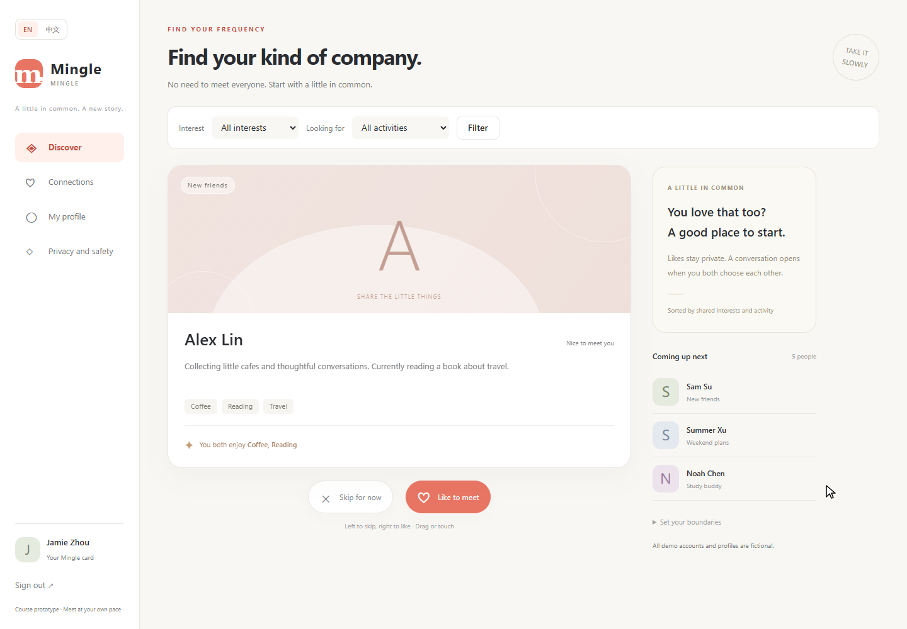
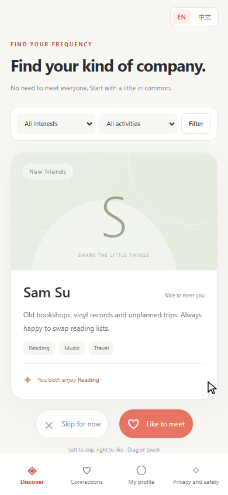
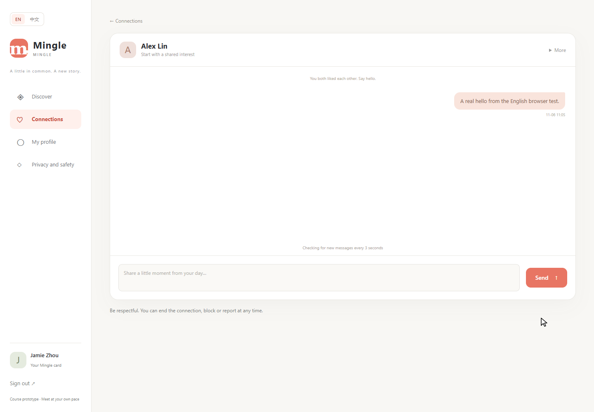

# Current Integrated Verification - 13 November 2026

The current application passed **66 Java tests, 7 reference-browser groups and 10 conversation-browser groups**, plus the executed PowerShell backup/restore fixture groups. See the [release report](releases/2026-11-13-reference-ui.md) and [portable results](releases/2026-11-13-verification.json) for scope, commands and limitations. The runtime runner skipped its own Maven invocation because the separate package run had already passed. Independent teammate review is not claimed.

The dated records below are historical and retain their original tested revisions.

# Historical Main Verification - 9 November 2026

Main revision `7551876875d1ddd403e1a272d28ade98e682cbf7` includes A's discovery/integration work and D's unread-state and bounded-history increment. A copy of the updated coursework source passed **47 Java tests, 16 discovery browser groups and 10 conversation browser checks**, with all three processes exiting successfully. The Java run used JDK 21 with zero failures, errors or skips. Both browser suites used the same packaged JAR, Edge 157.0.4341.42, Playwright 1.62.1 through the documented module override, and separate H2 databases.

The local demo was moved from 8081 to **8080** using the verified JAR and its previous database. All six fictional accounts were present before startup. The login page returned HTTP 200 and the served conversation script matched the current source. Existing passwords were retained; this readiness check does not claim a new login using the user's saved password.

See the [structured verification record](progress/week2/evidence/a-main-20261109/verification.json) and [startup/test instructions](LOCAL_DEMO.md). Runtime databases, credentials, machine paths and process identifiers are excluded from the published record. These are AI-assisted automated/local checks, not an independent teammate review or a public deployment.

Five launcher checks also passed with isolated databases on Windows PowerShell 5.1: explicit data-path precedence and first login, saved-data reuse with the original password, no password reset from a changed seed password, occupied-port refusal, and missing-saved-database protection. The persistent demo on 8080 remained available.

The dated records below retain earlier verification scopes and screenshots.

# Discovery increment verification — 6 November 2026

The new discovery/match increment passed **31 Java tests** (19 retained baseline + 12 new `DiscoveryRegressionTests`) and **11 browser assertion groups**, with exit code 0 for both processes. The first Java run had two template-expression errors; the original failure and successful retest are preserved in the [example evidence](../../../handoff/2026-11-06/A_Qin_Tian_Example/TEST_RESULTS.md). The tested JAR SHA-256 is `f60233a20b77ba0f9cbe951cb7b5b5e488ffdcbdfd89d1ee80fcfbb03b29c230`.

Browser verification used Edge 156.0.4314.58, Playwright 1.62.1 and isolated H2 data. It covered desktop and 390 px, emulated touch, keyboard/button request counts, correct match-to-chat navigation, language and reduced motion. Physical-device checks and B Wang Yikai's independent review remain pending. The previous baseline record below is retained as historical evidence; its direct-match-to-chat behavior is superseded by the explicit match-feedback page.

# Baseline Verification

Latest A increment: **39 Java tests and 16 browser groups passed** on 6 November 2026. See [A's current progress](progress/week2/A_progress.md) and [the exact source/run record](progress/week2/evidence/a-integration-20261106/verification.json). New user screenshots and independent review remain pending. The sections below retain the earlier 19-test baseline verification and its original images; those images are not evidence of the latest run.

Verified on **6 November 2026** on the local Windows machine, using JDK 21, Maven Wrapper and an isolated headless Microsoft Edge/Playwright browser. All accounts and messages used for verification were fictional. This is A's AI-assisted baseline verification, not evidence that B–F performed their reserved tasks or that user research took place.

## Automated Java checks

The final Mingle source was extracted from A's named handoff ZIP and built with JDK 21 and Maven Wrapper on 6 November 2026. `package` completed with exit code 0 and **19 tests, zero failures/errors/skips**. Dependencies were read from this task's already-populated Maven cache in offline mode, so this proves a clean source extraction and build, not a download on a new teammate machine. A branding assertion initially expected the old Chinese product name; it was updated to the selected Mingle name, and the suite passed. The original and corrected logs remain in the local handoff verification folder.

`mvnw.cmd --batch-mode --no-transfer-progress --offline test` completed with **19 tests, zero failures, zero errors and zero skipped**. Coverage includes registration and validation, own-profile editing, discovery exclusions, mutual matching, duplicate decisions, participant-only messaging, escaping, ending/blocking/unblocking, private report receipts and authenticated page rendering.

Four language checks verify English default despite a Chinese browser preference, persistent session switching and switching back, translated form validation and an unsupported language leaving the default unchanged. Raw local output: `.local/verification/maven-test.log`; XML reports: `target/surefire-reports/`.

The executable JAR was subsequently packaged successfully. An initial offline package lacked an uncached Maven plugin; it was downloaded through the normal Maven build. A later Windows file-lock failure during rebuilding was resolved by stopping the owned verification process before repackaging. The final package completed successfully; the log is `.local/verification/maven-package.log`.

## Browser checks

The same eight groups below were rerun successfully against the JAR from the extracted Mingle ZIP. The run also checked the Mingle page title and header. Final local output: `tmp/six-person-plan-20261106/mingle-clean-browser.json` in the coursework workspace. The screenshots below show this Mingle run. B–F must still verify their own increments and environments.

The final browser flow verified:

1. Public English/Chinese switching and English page text.
2. A short mouse drag returning the card without submitting.
3. A long right drag submitting a real server-side like.
4. A reciprocal like from a second session opening a conversation.
5. A real saved message appearing in the other session through polling.
6. An emulated mobile touch swipe submitting a skip.
7. A 390 × 844 layout, visible language control and no horizontal overflow in either language.
8. No browser exceptions or HTTP 5xx responses in the checked flow.

The first mobile run exposed a capture-transfer bug: a child element's `lostpointercapture` event bubbled to the card and reset the drag. The handler now reacts only when the card itself loses capture; the final emulated-touch run passed. This is browser touch emulation, not a claim of testing a physical phone. Earlier failing runs remain in the local verification folder.

## Restart and final English mode

The verification process was stopped and restarted against the **same H2 file database**. The connection and its previously sent message remained available after login. With `app.chinese-enabled=false`, a request for `lang=zh` still rendered English and no language switch was present. This verifies data retention for this local process-restart scenario; backup/restore tooling and independent clean-copy reproduction remain F's work.

Raw local summaries: `.local/verification/browser-state.json`, the final browser run's `results.json`, and `.local/verification/restart-result.json`.

## Not yet verified or implemented

No public deployment, physical-device matrix, high-load concurrency assessment, actual moderation service, real-user observation or independent team-member reproduction is claimed. B's live preview, C's password change, D's unread/history features, E's staff review and F's backup/restore tools are not in this baseline. Each member must add verification for their own increment.
