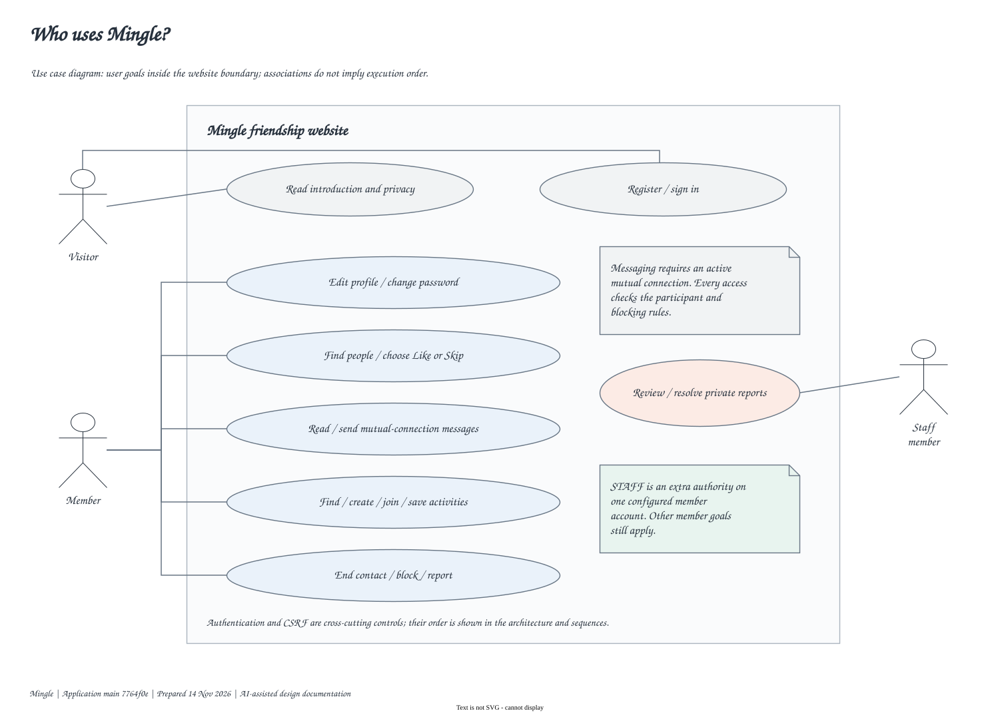
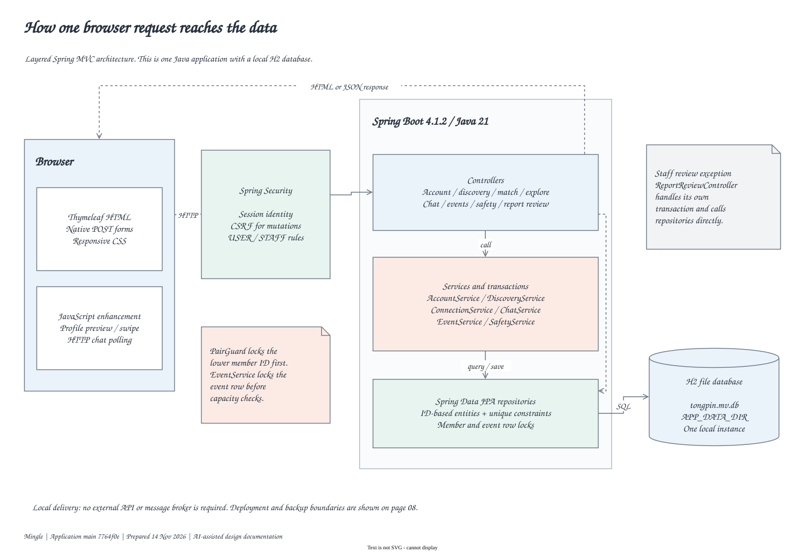
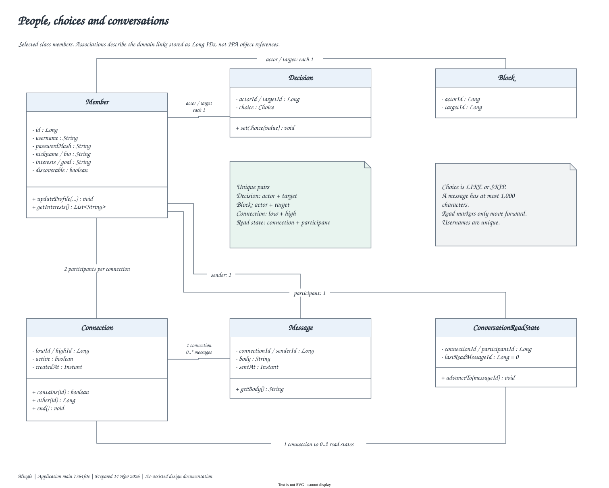
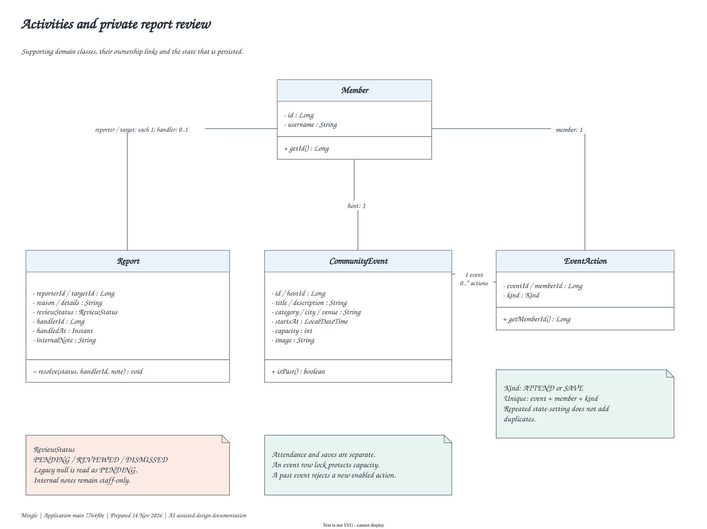
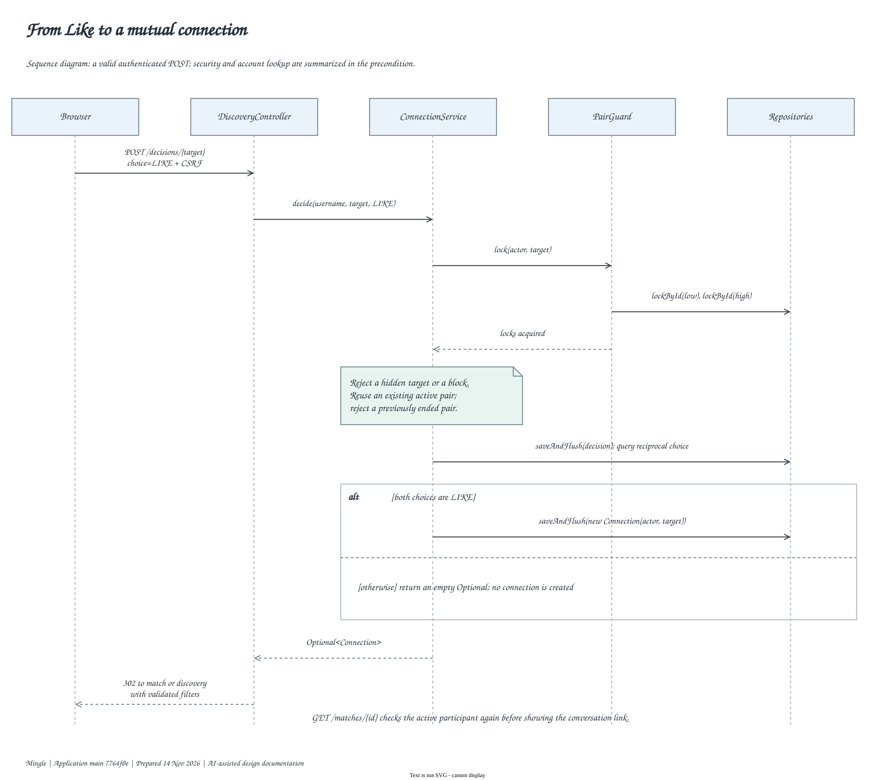
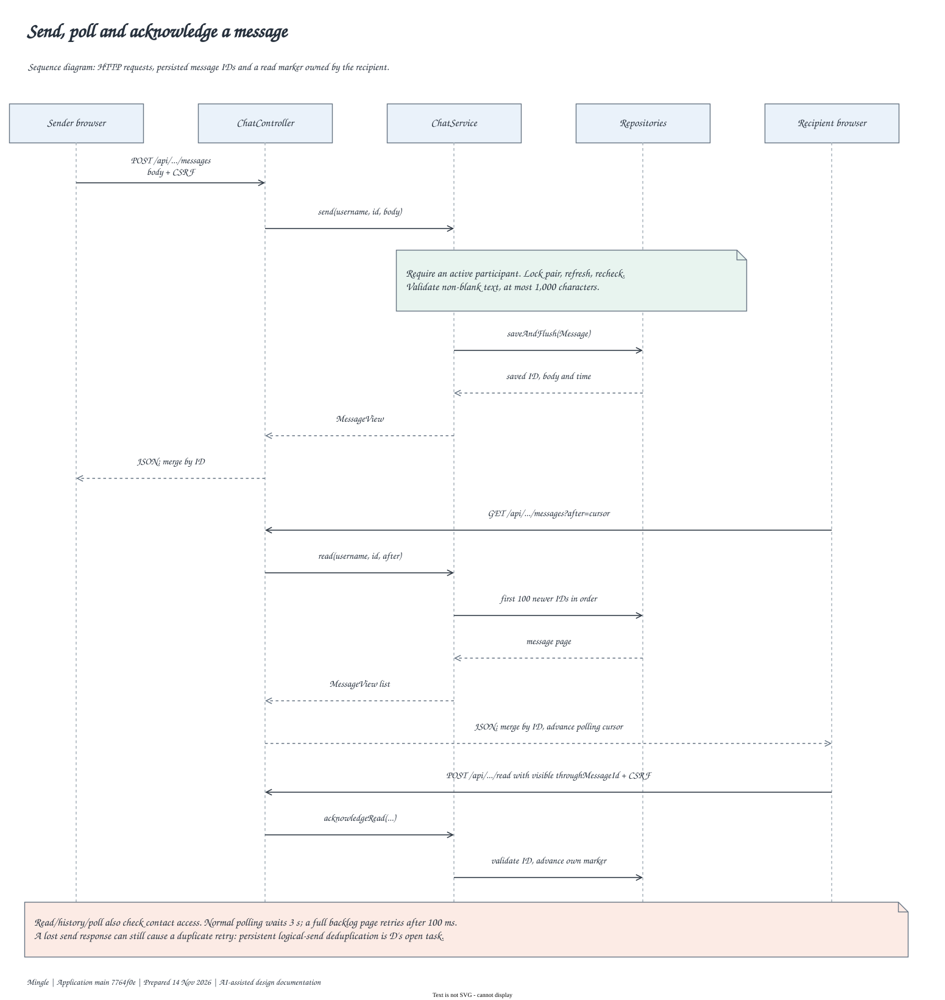
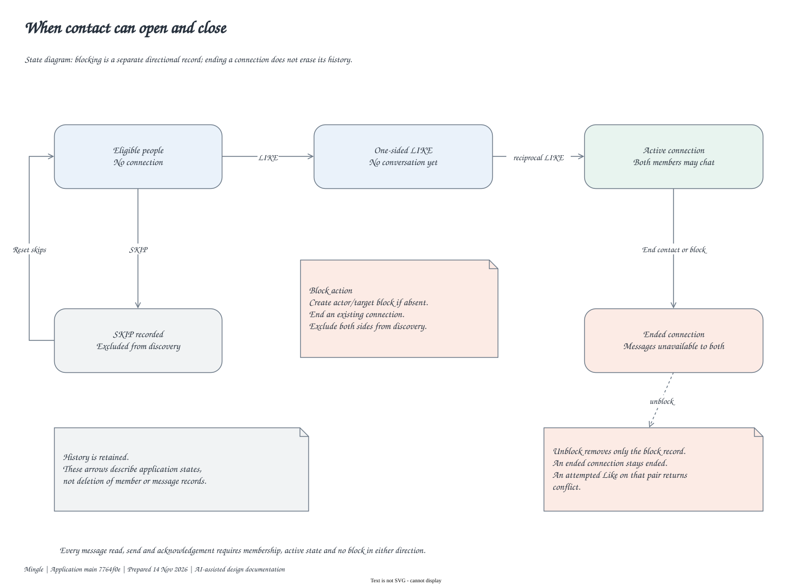
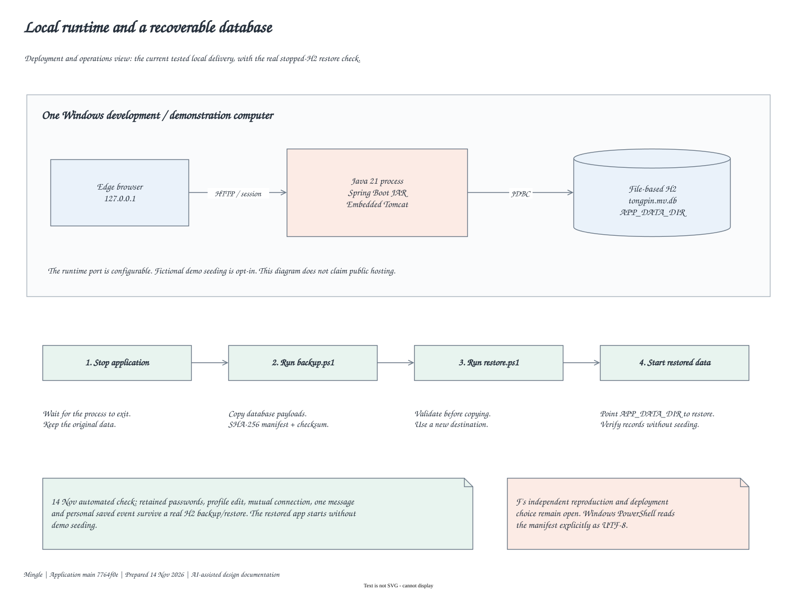
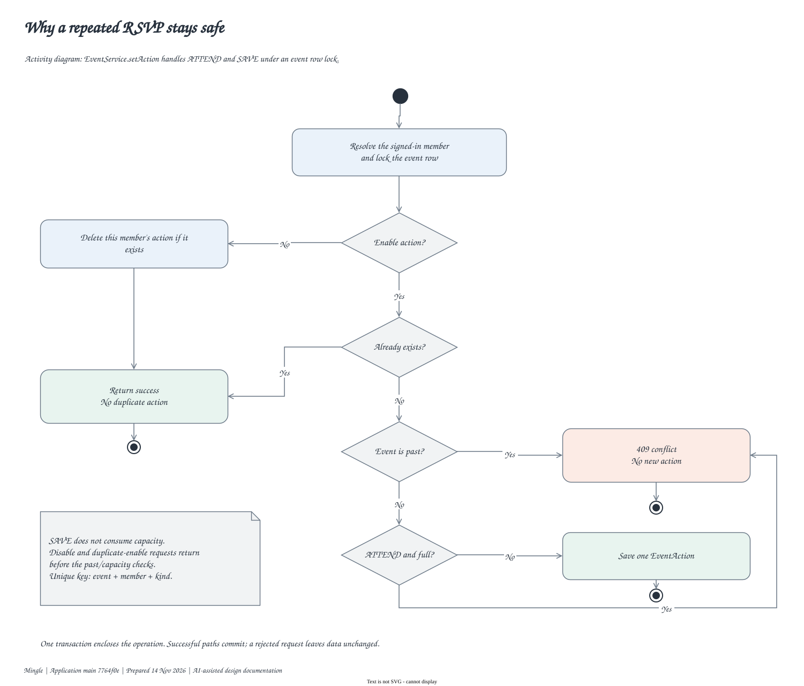
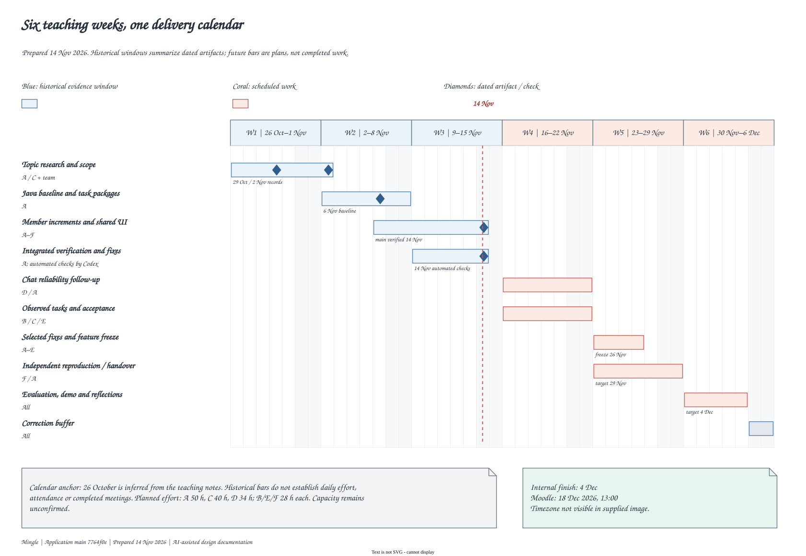

# Mingle design and six-week planning pack

Prepared 14 November 2026 from application main `7764f0e`, including PR #16, and the locally verified recovery-script fix. These are explanations of the implemented system and the current plan, prepared with AI assistance. They are not records of earlier design meetings.

Open the [ten-page editable Draw.io source](./Mingle_Design_and_Plan.drawio), the [ten-page vector PDF](./Mingle_Design_and_Plan.pdf), or the [browser gallery](./index.html). Each SVG below is a vector export of the corresponding page. Ordinary diagram text uses Comic Sans MS. All pages enable mathematical rendering; these diagrams contain code/type labels rather than mathematical equations.

The [verification report](../releases/2026-11-14-main-verification.md) gives actual test outcomes and open work. The [six-week XLSX Gantt](../../../../team-plan/project-management/six-week-gantt.xlsx) is an editable scheduling companion; Trello remains the daily working board.

## 01 Use cases

Distinguish visitor, signed-in member and configured staff goals. An association shows participation, not an execution sequence.

**Course connection:** Requirements and access boundaries.

**Explain in the demonstration:** Explain which goals require authentication and why staff review is restricted.

**Source:** [SecurityConfig.java](../../src/main/java/com/example/thematicfriend/config/SecurityConfig.java), [AccountController.java](../../src/main/java/com/example/thematicfriend/account/AccountController.java), [ReportReviewController.java](../../src/main/java/com/example/thematicfriend/safety/ReportReviewController.java).

## 02 Layered architecture

Trace the browser through Spring Security, controllers, transactional services, repositories and the local H2 store. The staff-review controller is shown as a real layering exception.

**Course connection:** MVC, separation of concerns and transactions.

**Explain in the demonstration:** Explain the choice of one deployable application and the tradeoff of direct repository access in staff review.

**Source:** [SecurityConfig.java](../../src/main/java/com/example/thematicfriend/config/SecurityConfig.java), [PairGuard.java](../../src/main/java/com/example/thematicfriend/connection/PairGuard.java), [ReportReviewController.java](../../src/main/java/com/example/thematicfriend/safety/ReportReviewController.java).

## 03 Core class model

Member, Decision, Connection, Message, Block and ConversationReadState store links as IDs. Selected fields and operations are shown, with uniqueness and cardinality rules.

**Course connection:** UML classes, encapsulation and database constraints.

**Explain in the demonstration:** Explain why domain associations here are not JPA object references and how unique keys prevent duplicate pairs.

**Source:** [Member.java](../../src/main/java/com/example/thematicfriend/account/Member.java), [Connection.java](../../src/main/java/com/example/thematicfriend/connection/Connection.java), [Decision.java](../../src/main/java/com/example/thematicfriend/connection/Decision.java), [Message.java](../../src/main/java/com/example/thematicfriend/chat/Message.java), [ConversationReadState.java](../../src/main/java/com/example/thematicfriend/chat/ConversationReadState.java), [Block.java](../../src/main/java/com/example/thematicfriend/safety/Block.java).

## 04 Activity and report classes

Separate attendance from saves, and public activity information from private report handling. Persisted report status and handler details belong to the restricted review workflow.

**Course connection:** Supporting domains, ownership and privacy.

**Explain in the demonstration:** Explain why a saved event does not consume capacity and who can read internal review notes.

**Source:** [CommunityEvent.java](../../src/main/java/com/example/thematicfriend/events/CommunityEvent.java), [EventAction.java](../../src/main/java/com/example/thematicfriend/events/EventAction.java), [Report.java](../../src/main/java/com/example/thematicfriend/safety/Report.java).

## 05 Mutual-match sequence

Follow a valid Like through member-pair locking, access checks, decision persistence and reciprocal detection. Only an active mutual connection leads to chat.

**Course connection:** Sequence diagrams and concurrency control.

**Explain in the demonstration:** Explain one-sided Like, repeated decisions, ended pairs and the order of pair locking.

**Source:** [MatchController.java](../../src/main/java/com/example/thematicfriend/discovery/MatchController.java), [ConnectionService.java](../../src/main/java/com/example/thematicfriend/connection/ConnectionService.java), [PairGuard.java](../../src/main/java/com/example/thematicfriend/connection/PairGuard.java).

## 06 Message and read-state sequence

Show send, recipient polling, older-history retrieval and acknowledgement as HTTP requests. Read state belongs to one participant. The diagram explicitly leaves logical-send retry deduplication open.

**Course connection:** Request/response protocols and asynchronous UI state.

**Explain in the demonstration:** Explain message IDs, recipient read cursors, polling intervals and why a lost response differs from a failed write.

**Source:** [ChatController.java](../../src/main/java/com/example/thematicfriend/chat/ChatController.java), [ChatService.java](../../src/main/java/com/example/thematicfriend/chat/ChatService.java), [ConversationReadState.java](../../src/main/java/com/example/thematicfriend/chat/ConversationReadState.java).

## 07 Contact state model

Separate mutual contact state from directional blocking. Ending retains history; unblocking removes the block without reactivating an ended connection.

**Course connection:** State machines and lifecycle invariants.

**Explain in the demonstration:** Explain why unblock is not a transition back to active contact.

**Source:** [ConnectionService.java](../../src/main/java/com/example/thematicfriend/connection/ConnectionService.java), [SafetyService.java](../../src/main/java/com/example/thematicfriend/safety/SafetyService.java).

## 08 Deployment and recovery

Show the tested single-machine runtime and the stopped-H2 backup/restore boundary. Restore creates a new destination and verifies checksums before reuse.

**Course connection:** Deployment, persistence and recovery.

**Explain in the demonstration:** Explain why copying a running H2 store is excluded and what the real recovery test actually verified.

**Source:** [backup.ps1](../../scripts/backup.ps1), [restore.ps1](../../scripts/restore.ps1).

## 09 RSVP activity flow

Trace enable/disable, duplicate detection, past-event rejection and capacity checks within one transaction under the event row lock.

**Course connection:** Activity diagrams, idempotent state-setting and race conditions.

**Explain in the demonstration:** Explain the duplicate/disable early returns and why attendance needs a locked capacity check.

**Source:** [EventService.java](../../src/main/java/com/example/thematicfriend/events/EventService.java), [EventActionRepository.java](../../src/main/java/com/example/thematicfriend/events/EventActionRepository.java).

## 10 Six-week Gantt

Separate historical evidence windows and dated artifacts from planned work. Use the inferred teaching-week calendar and the current internal completion target.

**Course connection:** Scheduling, dependencies and evidence.

**Explain in the demonstration:** Explain historical versus planned bars, the 4 December internal finish and capacity uncertainty.

**Source:** [plan](../../../../team-plan/16_six_week_evidence_plan.md).

## Validation and limits

Draw.io 32.6.1 exported all ten pages as SVG and PNG with successful export exits. The strict source audit reported zero errors and zero warnings. Rendered pages were reviewed for labels, connector routing, clipping and font appearance. All ten SVGs loaded in the local Edge gallery; desktop and 390 px layout checks passed. The [verification record](./verification.json) and [source manifest](./source-manifest.json) identify these checks and the code used. The original temporary renders and audit logs remain outside this delivery folder. The user's Markdown editor and native Excel UI were not tested; the [schedule verification](../../../../team-plan/project-management/VERIFICATION.md) records the spreadsheet authoring-process limitation. This is a selected design model, not a complete listing of every class or deployment configuration. The historical critical-path workbook remains a separate earlier estimate and has not been silently presented as a recalculated six-week resource plan.

## PDF export

The ten-page PDF contains vector content and embedded font subsets for Comic Sans MS regular and bold. No raster images were found. All ten pages were rendered and visually reviewed. SVGs retain editable vector shapes/text and require Comic Sans MS to reproduce that font on another machine; the PDF embeds it.
