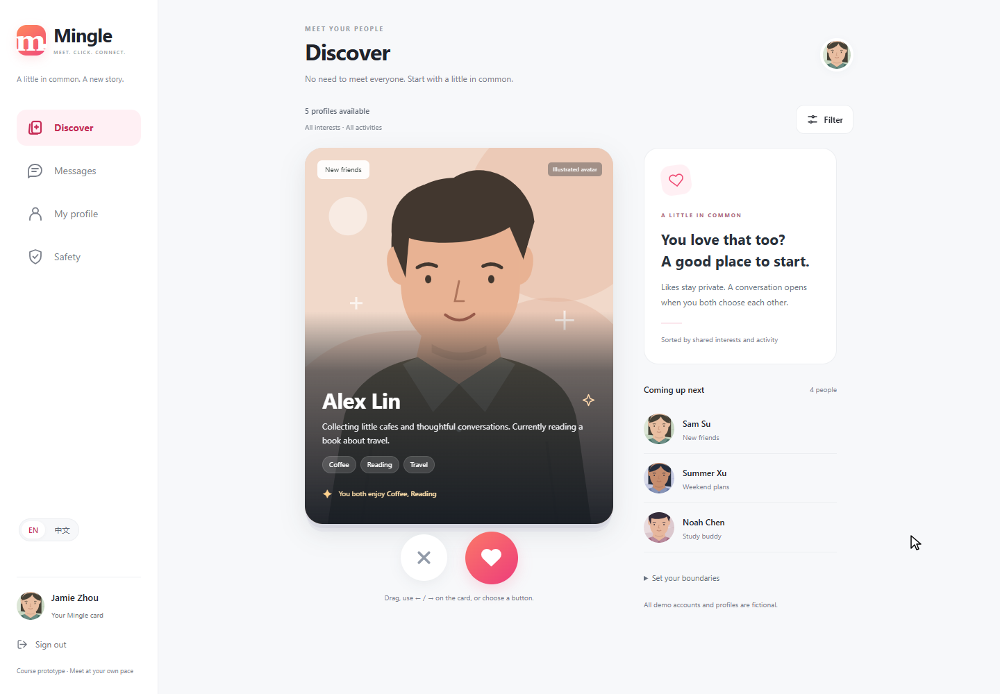
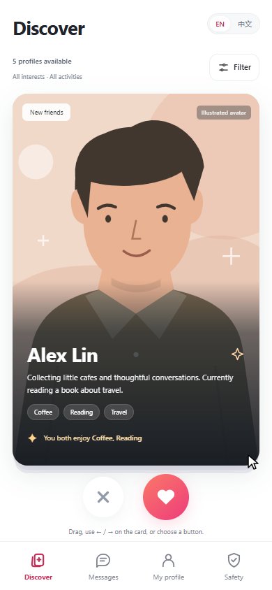
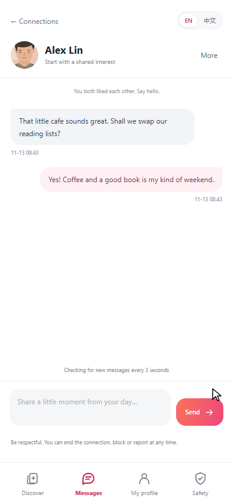

# A — Mingle interface review, 13 November 2026

The discovery screen now uses a tall illustrated card, prominent round skip/like controls and a compact filter sheet. Phones have bottom navigation; desktop retains a sidebar and supporting discovery information. The inbox shows actual connections and unread counts, while chat, the saved profile and public entry pages share the same coral/pink styling.

The supplied Momo/Tantan reference screenshots informed layout and navigation. The five SVG avatar illustrations and navigation icons are original decorative assets made with Codex assistance. The avatars are placeholders, not uploaded profile photos, identity verification or online-status indicators.

This is A's assisted interface increment on the merged `ebf3533` baseline. D's merged unread/history implementation is retained. B's live profile preview, C's password changes, E's staff report review and F's backup/restore work remain their own increments. The profile preview here continues to show the saved profile.

## Review the actual application

Start the local demo using `scripts/run-demo.ps1` and open `http://127.0.0.1:8080/login`. Existing accounts keep their existing passwords. Use a second private browser session when checking reciprocal likes and messages.

1. Inspect Discover on desktop and at a phone width. Open Filter, choose interests and an activity, then remove a filter.
2. Use skip/like, dragging or the keyboard. Only mutual likes should open a conversation.
3. Check the inbox, send a message from the other session, and verify the recipient's unread indicator and conversation.
4. Check My profile, Safety and mobile sign-out. The profile card updates after saving.
5. Switch EN / Chinese and check spacing, text and controls. Record any preference or reproducible defect before approving.

## Verified results

| Check | Result |
| --- | --- |
| Existing Java tests | 47 passed; no failures, errors or skips |
| Existing discovery browser suite | 16 groups passed |
| Existing conversation browser suite | 10 groups passed |
| New UI acceptance suite | 6 groups passed, including 320/375/390/768 px layouts |
| Final package | SHA-256 `dadeb48ee7e475998d93d43692bce69da6a261883e22dbc1bf34c5fc990b4e7c` |

The Java/template test run preceded the final CSS corrections. The final CSS was packaged with `-SkipTests`, then all three browser suites passed against that exact JAR. The portable UI runner also passed after the user moved the local project to `AAAAA-code/thematic-friend`; the JAR hash remained identical. [Machine-readable verification](./evidence/ui-refresh-20261113/verification.json) records the checks.

The checks found and corrected a short-screen decision-button overlap, an overflowing inbox row, chat composer padding conflicting with mobile navigation, and decorative homepage overflow. An early source-only preview also exposed stale bundled language keys; packaged verification uses the complete updated resources. Earlier failed runs remain in the local QA output. No independent human approval or physical-phone test is claimed.

## Automated visual evidence

All images below are genuine Edge/Playwright captures on 13 November 2026 using isolated fictional fixtures. They do not replace Qin Tian's own terminal, code or classroom photographs.

### 1. Desktop discovery — 13 November 2026

### 2. Mobile discovery — 13 November 2026

### 3. Mobile conversation — 13 November 2026

Implementation and verification were assisted by Codex. Qin Tian's UI review and independent teammate review are pending.
