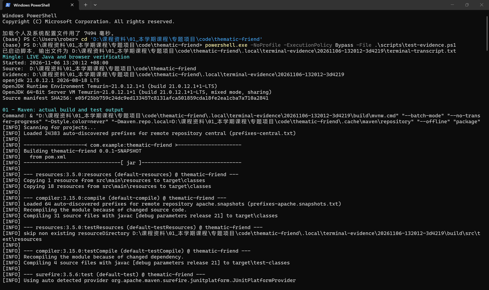
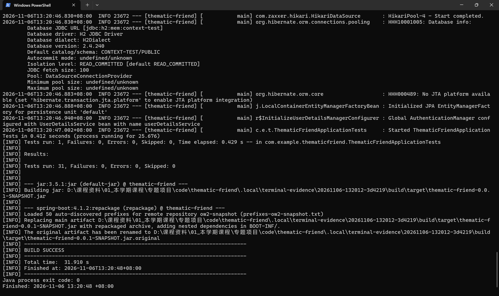
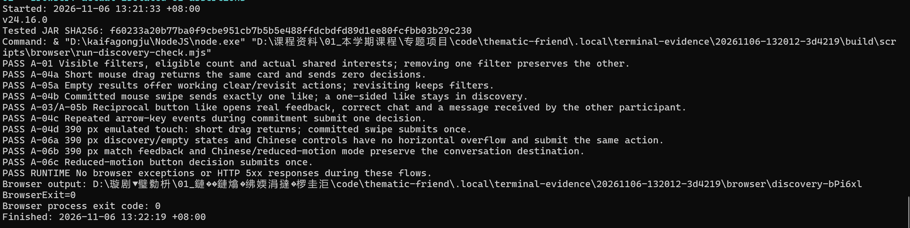
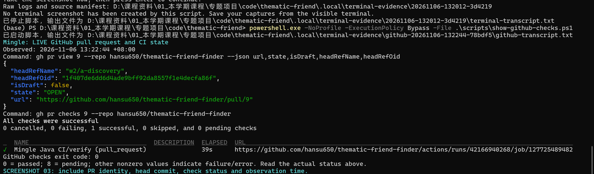
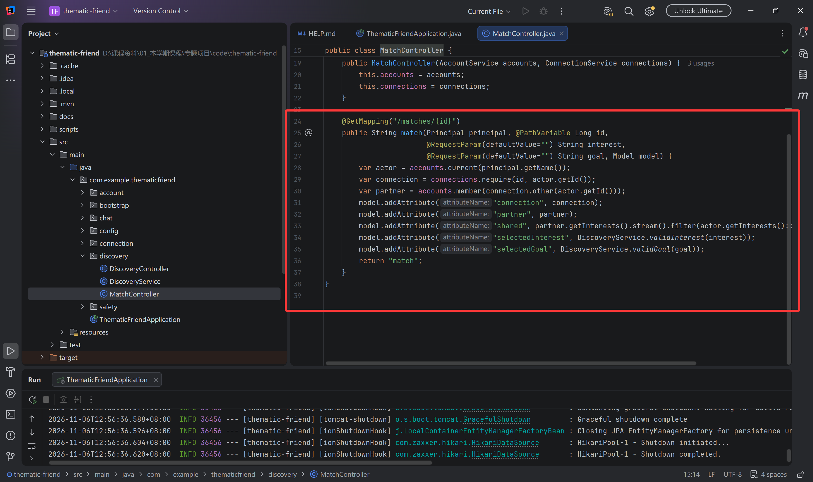
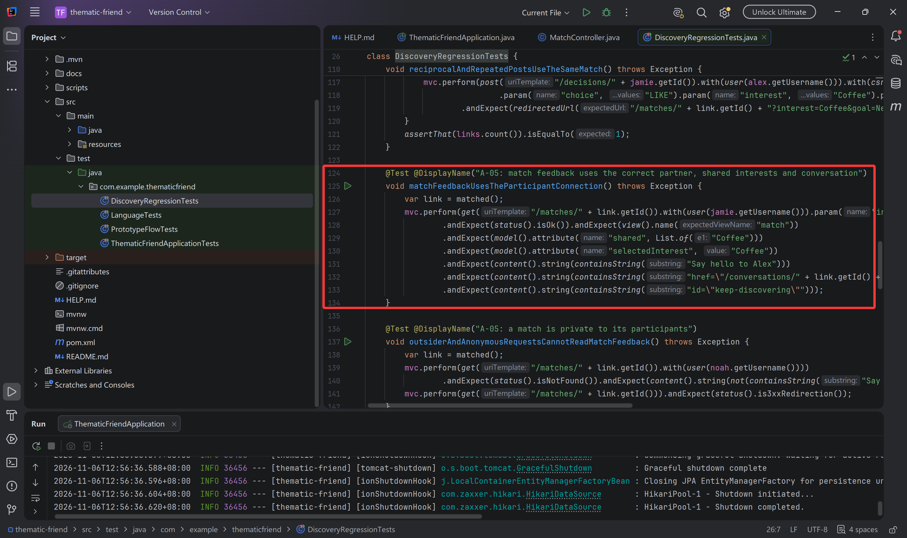

# A Qin Tian Discovery and Integration Progress

6 November 2026. Branch: w2/a-discovery. [PR #9](https://github.com/hansu650/thematic-friend-finder/pull/9) is the active A review. Independent reviewer **B Wang Yikai** is pending. The remaining owner agreements, five incoming modules, final acceptance and demonstration coordination are assigned work.

## Second increment: recovery and integration preparation

The second increment preserves validated filters on error recovery, refreshes discovery when a cached history page is restored, and announces a pending choice while suppressing duplicate input. Existing rejection statuses and JSON errors are retained. Native CSRF-protected forms work without JavaScript. No database fields or B–F feature implementations were added.

Verification passed **39 Java tests** (the previous 31 plus 8 new integration cases) and **16 Edge/Playwright groups** (the previous 11 plus 5 new groups), with both process exit codes 0. The Java build ran at 14:19–14:20 +08:00; browser-only retests used its exact JAR. Its SHA-256 is `826e62b9b93e938cf64905e12ad7b7d76c38f165c37d41585e345da0fe1ca153`. All 60 Java/build-input files still match that frozen build. See [machine-readable verification](./evidence/a-integration-20261106/verification.json), [Java output](./evidence/a-integration-20261106/java-output.txt), [browser output](./evidence/a-integration-20261106/browser-output.txt) and [assertion results](./evidence/a-integration-20261106/browser-results.json).

Before implementation, the eight new Java integration cases had four missing-recovery failures. The first browser attempt exposed a harness wait conflict; subsequent harness attempts used an incorrect generated checkbox ID and failed to open the chat menu. Their real outputs are retained beside the passing results. The application/Java inputs did not change during those browser-only fixes. These were corrected test-harness problems, not claimed new product defects.

The new Java cases cover stale hidden/blocked cards, safe recovery parameters, the HTTP match → chat → end flow, report privacy and unblock semantics, missing-CSRF rejection and temporary Chinese recovery. The browser additions check pending feedback/duplicate suppression, real Back navigation plus an explicitly simulated persisted-pageshow event, native buttons without JavaScript, another session hiding a profile, and a closed match link. Touch remains emulated; no screen-reader audit, load certification or independent review is claimed.

[Concrete contract proposals and the integration gate](../../INTEGRATION_PLAN.md) are ready for B–F to review. Their confirmation and implementation are still pending. [The next capture guide](../../A_NEXT_CAPTURE.md) gives commands and a repeatable two-session product scenario. **New user terminal/editor/product screenshots are pending; this verification run saved no automatic browser images.** The six original images below belong to the first increment.

Current optional editor references: [PageAdvice.java](../../../src/main/java/com/example/thematicfriend/config/PageAdvice.java), lines 37–56; [app.js](../../../src/main/resources/static/js/app.js), lines 9–42; and [AIntegrationTests.java](../../../src/test/java/com/example/thematicfriend/AIntegrationTests.java), lines 104–130. These show safe recovery, cached-history/pending handling and the cross-route closure assertions. Source/test preparation used Codex assistance under A's ownership; Qin Tian's own explanation and B's independent review remain separate evidence.

## First increment: implemented and checked

The AI-assisted baseline already supplied accounts/profiles, filtering, mutual matching, basic chat and safety actions. A's increment adds removable filter summaries and eligible counts, useful empty-result recovery and participant-only match feedback leading to the correct conversation. Genuine shared interests come from stored profile intersections.

Local verification passed **31 Java tests** (19 retained baseline + 12 new regressions) and **11 browser groups**, with exit 0. Qin Tian ran the capture workflow at 13:20–13:22 +08:00 on 6 November. The GitHub capture at 13:22:44 records passing CI for commit 1f407de; it is a snapshot of that observation. See [verification scope](../../VERIFICATION.md) and [browser reproduction](../../../scripts/browser/README.md). Touch is emulated; independent review is separate.

## Actual terminal screenshots

Command and source identity:

31 tests, BUILD SUCCESS and process exit 0:

11 browser groups, BrowserExit=0 and process exit 0. The original output-path encoding artifact is retained:

PR #9 and actual GitHub checks at capture time:

## Code explanation

[MatchController.java](../../../src/main/java/com/example/thematicfriend/discovery/MatchController.java), lines 24–37, resolves the session user, validates participation, derives the partner/shared interests and renders match feedback.

[DiscoveryRegressionTests.java](../../../src/test/java/com/example/thematicfriend/DiscoveryRegressionTests.java), lines 124–134, checks the expected partner, common interest, retained filter and conversation destination.

Some long lines extend beyond the right edge in the supplied editor screenshots; the linked source files retain the complete statements. All six original PNGs keep their original resolution and bytes. [Original-name mapping and hashes](./evidence/A_user_captures_20261106.json). B–F need source/test files and explanations; code screenshots are optional for them.

## Remaining A work

1. Agree account/session, read-state, staff-role and data-path contracts with the assigned owners.
2. Review and integrate accepted B–F PRs; resolve shared integration defects with the affected owners.
3. Lead CORE-01–08 on the final integrated revision and the English interface check.
4. Coordinate product evaluation, the demonstration narrative and handover; write A's own evidence-based reflection.

The largest individual allocation remains A 42 planned hours versus 28 per teammate, including testing, review and coordination. These are estimates, not actual contribution hours. [Shared finish line](../../../../../team-plan/14_final_acceptance_and_assessment.md).

Code, tests, capture scripts and documentation used Codex assistance. Qin Tian supplied the six terminal/editor screenshots. B's review, teammate contributions, user observations and later integrations will be recorded when performed.
