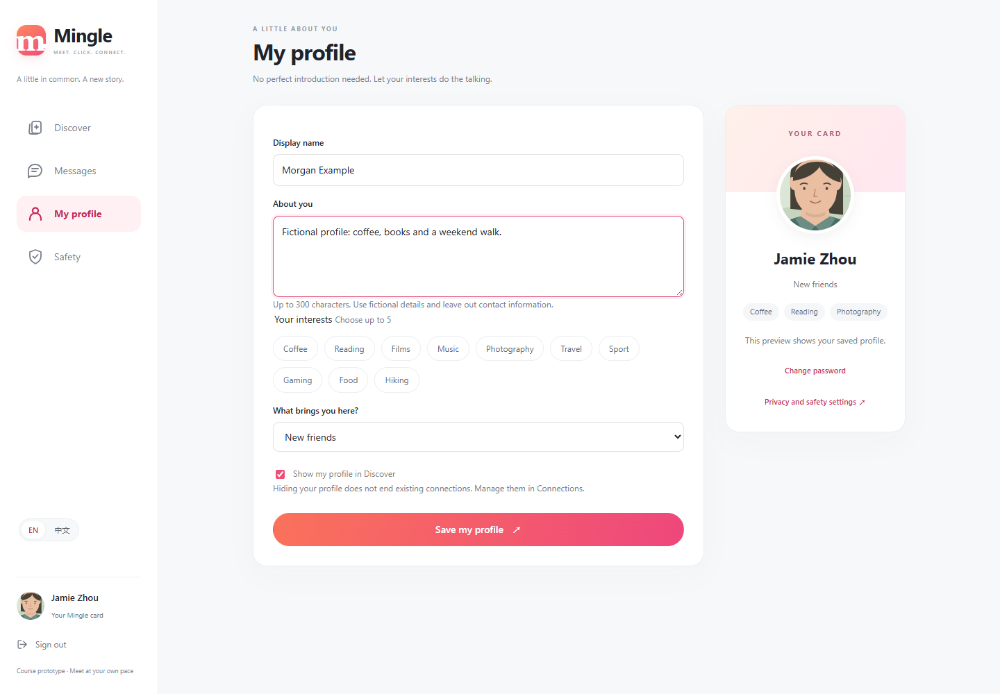
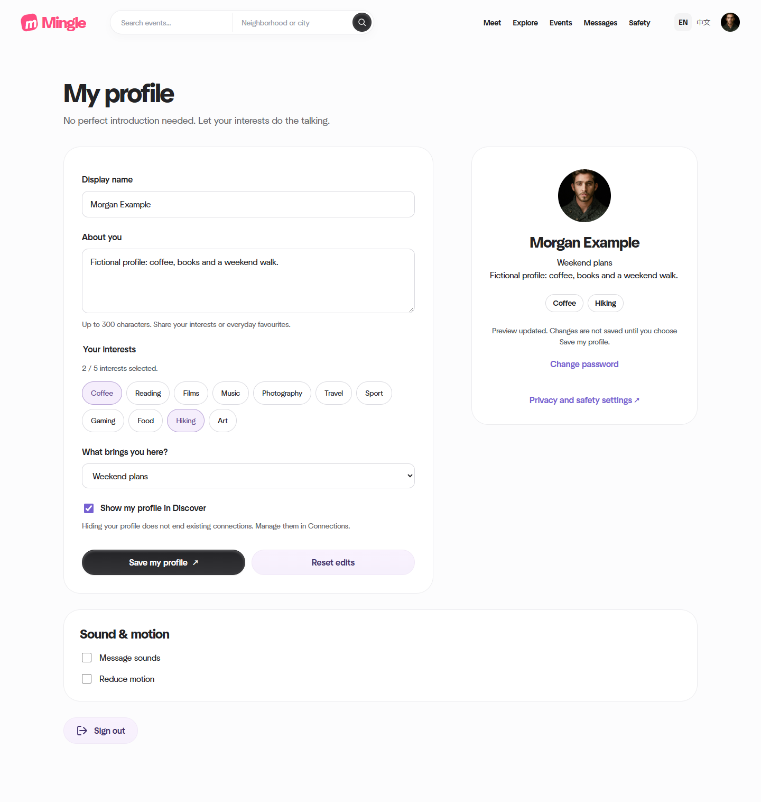
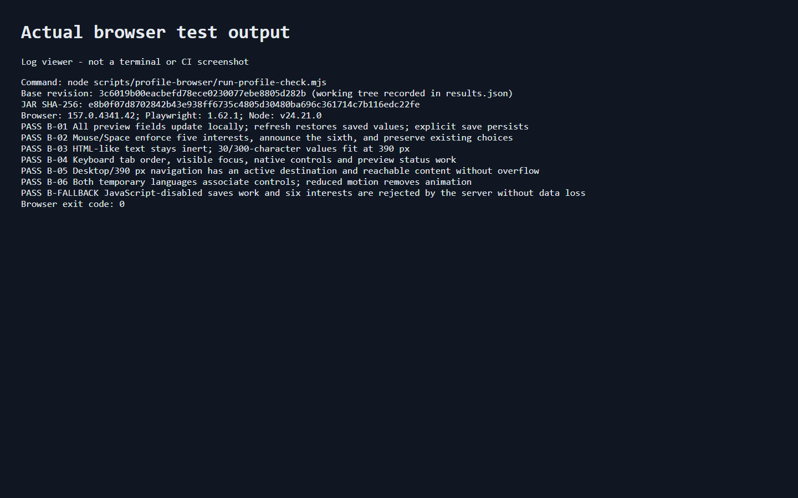

# B Wang Yikai: Week 2 Profile Interaction

Named task owner: **Wang Yikai (B)**. Assigned reviewer: **C Tao Jiacheng**. Integration owner: **A Qin Tian**. Date: **13 November 2026**.

**Code and automated checks are ready for review.** Consented user observation and C's independent review remain pending. The user explicitly requested submission of code and tests first because no participant records are available.

## Baseline and contribution

Work began from main `e8d14813b8cef985f9e6cef8976d3395ff59e221`. While this task was running, PR #15 changed the shared interface and backend. This increment was rebased onto main `91d3b324bd522152bd34e9af44ffb6e1a683d1cb`, preserving the updated photos, navigation, sound/motion preferences, event features and backend contracts.

A owns the existing application and shared visual design. This submission adds B's profile interaction and accessibility increment with Codex assistance. It does not establish unaided authorship, personal hours, participant feedback, team agreement or a completed peer review. Planned workload is not reported as actual time.

Submission branch: [w2/b-interface](https://github.com/hansu650/thematic-friend-finder/tree/w2/b-interface). Pull request: recorded after publication.

## Implemented behavior

- Name, biography, activity goal, interest chips and initial update while editing. The script uses `textContent` and DOM nodes; it does not send draft values or persist them in browser storage. Reload restores saved values. Only the native Save form submits data; Reset restores the initial form.
- A selected-interest counter announces the count and identifies a rejected sixth choice. Mouse and Space retain the existing five choices and focus. Server validation remains authoritative when JavaScript is disabled.
- Labels, validation descriptions, visible keyboard focus and polite status regions support editing. Interest chips have a 44 px minimum height, long text wraps, and the narrow-screen visual order follows the form's reading order.
- The current shared navigation exposes Meet, and account/mobile menus identify the active destination. Profile-only assets are loaded by the current reference head. Existing sound/motion preferences are retained.
- English is the default. The required temporary Chinese localization is retained and tested. All new documentation, comments, commit messages and PR text are in English.

Main sources: [profile template](../../../src/main/resources/templates/profile.html), [preview script](../../../src/main/resources/static/js/profile-preview.js), [scoped stylesheet](../../../src/main/resources/static/css/profile-preview.css), [shared reference fragment](../../../src/main/resources/templates/fragments/reference.html).

No route, database field, migration, password policy or backend interest-limit change is introduced.

## Executable checks and actual results

[Browser runner and reproduction guide](../../../scripts/profile-browser/README.md) includes pinned dependencies and clean Chromium/installed-browser options.

| Check | Expected behavior and observed result |
|---|---|
| B-01 | PASS: four preview fields update locally; no editing POST; another page and reload show saved data; explicit Save persists all fields. |
| B-02 | PASS: select/deselect with mouse and Space; visible selected chips; sixth interest rejected with named feedback; original choices and focus preserved; Reset works. |
| B-03 | PASS: HTML-like input stays inert; no injected element, script or dialog; 30/300-character text fits at 390 px. |
| B-04 | PASS: keyboard traversal, 3 px focus outlines, Space/Enter actions and polite live-region updates. |
| B-05 | PASS: Profile, Meet, Messages and Safety work at 1440 and 390 px; active navigation is reachable; no horizontal overflow; Save passes an actionability check. |
| B-06 | PASS: English/Chinese labels and announcements; reduced-motion animations absent and transitions at most 0.01 ms, matching the shared theme. |
| B-FALLBACK | PASS: without JavaScript, the server rejects six interests without changing saved data, preserves attempted input, and accepts a valid native save. |

Final local results:

- **66 existing Java tests passed**, zero failures/errors/skips: [full output](evidence/B-20261113/java-output.txt), [exit code](evidence/B-20261113/java-exit.txt).
- **7 new B browser groups passed**, exit 0: [output](evidence/B-20261113/browser-output.txt), [results and source SHA-256 manifest](evidence/B-20261113/browser-results.json).
- **16 existing A discovery/runtime groups passed**, including mouse, keyboard, emulated touch, mutual-match chat, recovery, no-JavaScript actions and no browser exceptions/HTTP 5xx: [output](evidence/B-20261113/peer-output.txt), [results](evidence/B-20261113/peer-results.json), [exit code](evidence/B-20261113/peer-exit.txt). These are automated cross-module checks, not C's independent acceptance.

The final browser run records local base commit `3c6019b00eacbefd78ece0230077ebe8805d282b` plus its working-tree changes. The complete source hash manifest identifies the exact tested files before remote publication. Tested JAR SHA-256: `e8b0f07d8702842b43e938ff6735c4805d30480ba696c361714c7b116edc22fe`.

Environment: Windows, Java 21.0.12.1, Maven Wrapper 3.10.0, Node 24.21.0, Playwright 1.62.1, installed Edge 157.0.4341.42. Each browser suite used its own random password, new fictional demo database and loopback listener.

Actual commands were run from `code/thematic-friend`:

```powershell
$env:MAVEN_USER_HOME = Join-Path $PWD '.cache/maven'
.\mvnw.cmd --batch-mode --no-transfer-progress -o package
node scripts/profile-browser/run-profile-check.mjs
node D:/Codex/Work/b-profile-week2/run-peer-discovery-check.mjs
```

`JAVA_HOME` and `MINGLE_BROWSER_PATH` selected the versions above; `MINGLE_TEST_OUTPUT`, TEMP and TMP pointed to the D: task workspace. Offline Maven used dependencies obtained during setup. The first dependency download required a network retry.

The original A launcher timed out while the enlarged application was starting on this machine. A scratch launcher increased only startup polling from 100 to 300 bounded attempts and retained the original browser assertions. [Wrapper/source hashes](evidence/B-20261113/peer-wrapper-note.json), [actual timeout](evidence/B-20261113/peer-startup-timeout.txt), [successful run metadata](evidence/B-20261113/peer-run.json). This is not reported as an unchanged-launcher pass.

## Real defects, decisions and retests

1. Preview initialization initially read an absent generated checkbox ID. An explicit discoverable ID fixed it. [Failure output](evidence/B-20261113/defect-preview-output.txt) and [screenshot](images/B-20261113/B_failure_preview.png); final B-01/B-04 pass.
2. Thymeleaf inserted hidden fields between interest checkboxes and their label spans. Adjacent-sibling CSS missed selected/focus styles. Scoped general-sibling selectors now support the actual rendered DOM. [Failure output](evidence/B-20261113/defect-focus-output.txt) and [screenshot](images/B-20261113/B_failure_focus.png); final B-02/B-04 pass.
3. On the starting UI, scrolling could leave Save behind fixed bottom navigation. A scroll-padding correction passed before integration. The new main replaced that navigation; the final test verifies actionable Save controls on the current layout. [Original failure](images/B-20261113/B_failure_mobile.png), [pre-integration pass](evidence/B-20261113/pre-integration-pass.txt), final B-05 pass.
4. The first integrated B-06 check expected exactly zero transition duration. Main's reduced-motion setting uses 0.01 ms. The assertion now checks that documented near-zero bound and no animation, without altering main's preference behavior. [Initial assertion output](evidence/B-20261113/integration-motion-assertion.txt), final B-06 pass.

Developer-observed usability improvements include visible selected interests and keyboard focus, clear unsaved-state feedback, and matching narrow-screen visual/reading order. These findings are not participant observations.

## Screenshots and provenance

Before: the original `e8d1481` templates show the saved card despite edited form fields. These captures used a template overlay on the then-current JAR with unchanged backend/shared CSS; they are not an old-binary run or a comparison with the later PR #15 visual redesign. [Method and template hashes](evidence/B-20261113/baseline-results.json).



After: the final integrated live preview.



Additional evidence: [five-interest boundary](images/B-20261113/B_boundary.png), [390 px layout](images/B-20261113/B_mobile.png), [safe long text](images/B-20261113/B_safe_text.png), [keyboard state](images/B-20261113/B_keyboard.png), [temporary Chinese](images/B-20261113/B_chinese.png).



The last image is explicitly a browser-rendered viewer of the real output log, not a terminal or CI screenshot. Databases, server logs, passwords, caches and build artifacts are excluded from this submission.

## Remaining evidence and handover

- **User observation: pending.** No participants, consent records, observed task timings or feedback were supplied. Do not mark this complete until real observation is arranged.
- **Independent review: pending.** C should reproduce relevant checks and review the shared-template additions; A decides integration. No prior A/F coordination or acceptance is claimed.
- **Trello update: pending.** Opening the specified board through the connected browser timed out twice. No card or board change is claimed. Suggested review cards: live preview; selection/accessibility; browser evidence. The GitHub PR is the concrete review artifact.
- Real screen-reader announcements and physical-phone behavior remain untested. Current accessibility evidence covers semantics, focus and browser interaction at emulated widths.

References: the supplied B task package, [B's test plan](../../../../../team-plan/tasks/testing/B_tests.md), [UI reference map](../../../../../team-plan/12_ui_reference_map.md) and the current A-owned application. Layout references 4/7/9 are background context; existing main's design and assets are preserved. Codex assisted with implementation, debugging, test execution, evidence preparation and GitHub submission. B remains responsible for understanding and explaining the work.
