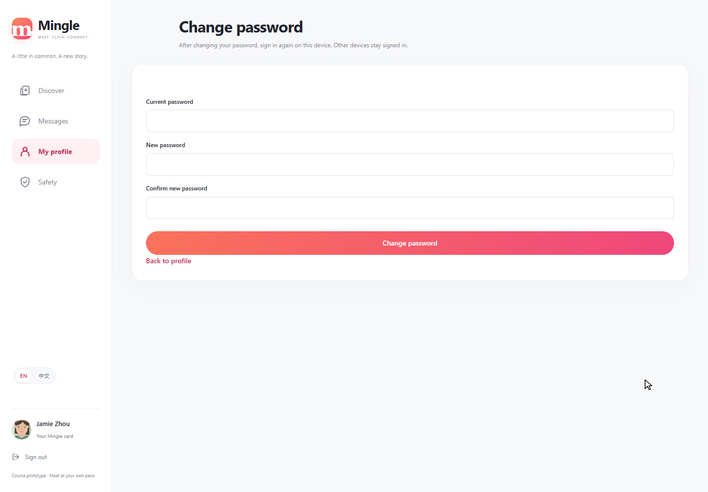
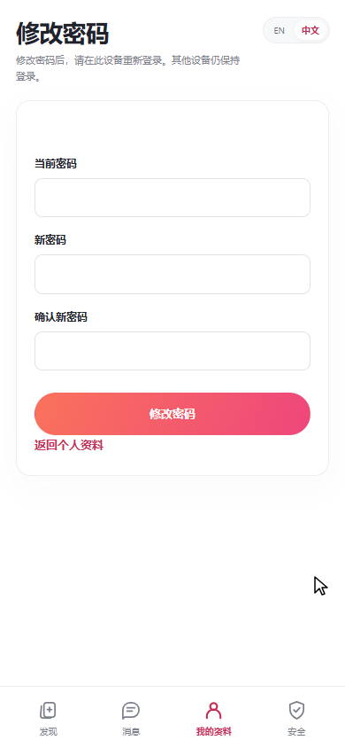
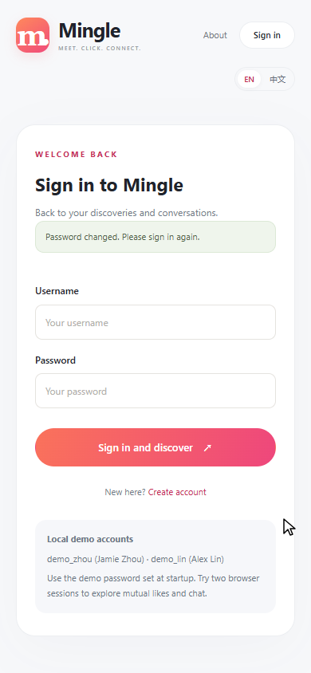

# PR #11 conflict resolution — 13 November 2026

The password-change branch now includes main at `c9178af876d33640c01db4dd1c9fc87d303129eb`. The profile page retains main's Mingle layout and mobile sign-out control, with C's Change password link added. The password form uses the same `mingle-app` page shell. No unfinished local UI redesign is included.

## Verification

- JDK 21.0.12.1: Maven package passed; 52 tests, 0 failures, 0 errors, 0 skipped.
- Existing UI browser runner: 6 groups passed on installed Microsoft Edge, using an isolated database and two demo sessions. Covered filtering, 320/375/390/768 px layouts, matching, messages/unread counts, profile/safety/logout, public pages and browser errors.
- Password browser check: 7 groups passed. Wrong current password, mismatched confirmation, English desktop and Chinese 390 px form, success notice/current-session logout, other-session retention, old-password rejection/new-password login, and no JavaScript or server errors.
- Password fields were empty after a rejected submission; no credentials are present in the screenshots or this record.
- The verified packaged JAR SHA-256 was `1a2b1b456bab12957fbd57c85e64bf80542d91dfde8ba73897446d618a3095a6`.
- Screenshots below were inspected. Mobile checks use viewport emulation, not a physical phone. Peer review remains for a teammate.

The current-session policy is intentional: changing a password signs out this session; existing other sessions remain signed in. The form explains this in both languages.

## Real browser captures

## Repeat the repository checks

From `code/thematic-friend`, use Java 21 and run `./scripts/build.ps1` on Windows, then `node scripts/ui-browser/run-ui-check.mjs` with Playwright and a Chromium browser configured as described in `scripts/ui-browser/README.md`. `ChangePasswordTests` contains the server-side password, validation, CSRF, ownership and two-session cases.
