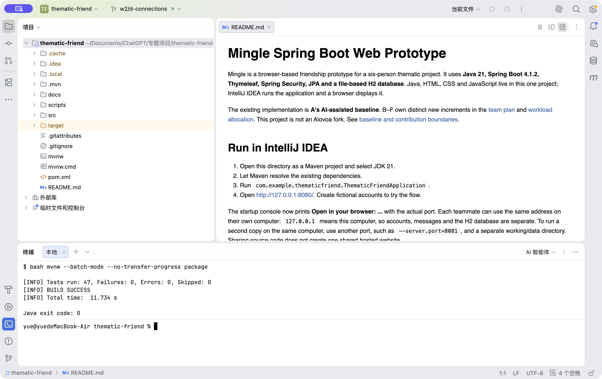
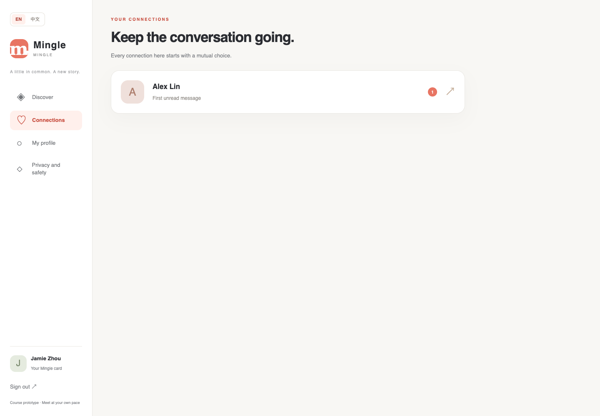
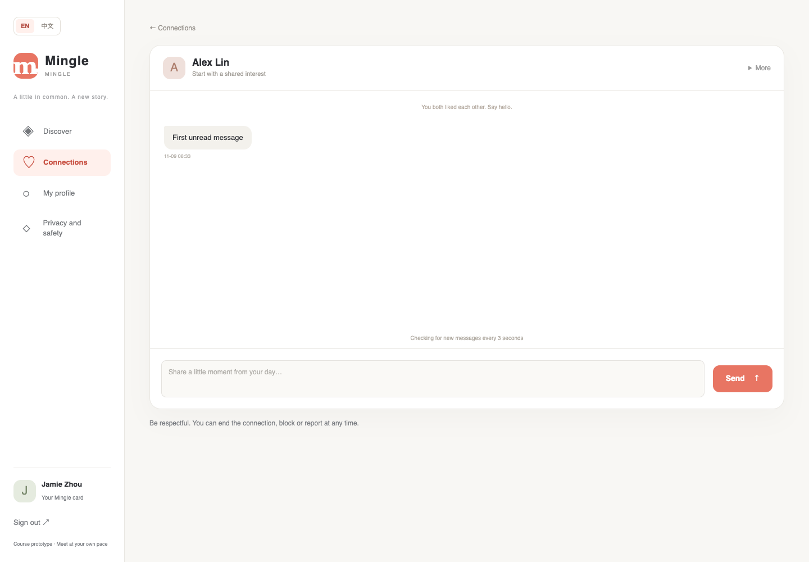
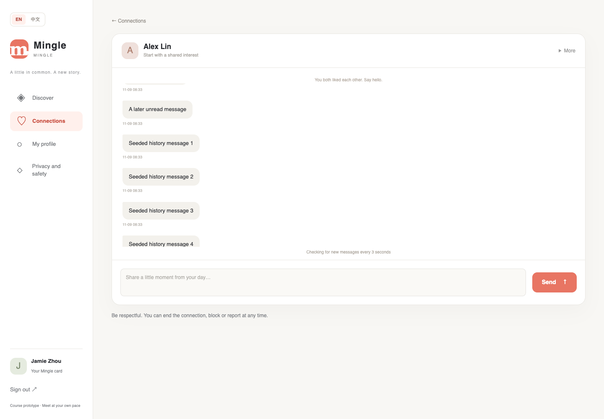
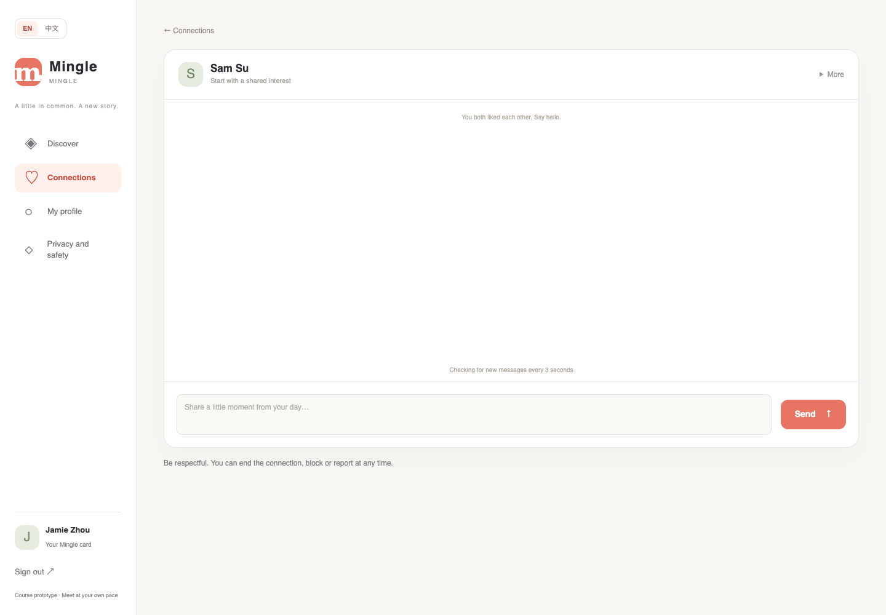
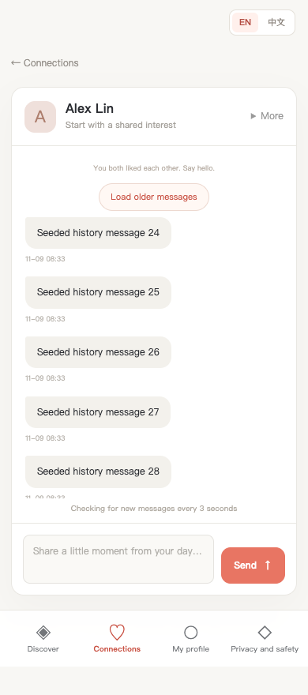

# D Zhou Ziyue Progress

Task: Unread state, older-message history and conversation integration
Date: 9 November 2026
Tested source: `a70a9c1` on `w2/d-connections`
Status: Implemented and locally verified after main integration; contract confirmation, peer review, PR checks and Trello evidence remain pending.

## Actual change

- Added a separate `ConversationReadState` row per `(connectionId, participantId)`. The marker only advances, and unread count includes messages from the other participant above that marker.
- Added `GET /api/conversations/{id}/history?before=<messageId>` with at most 100 older messages, ascending ID order, `hasOlder` and `nextBefore`.
- Added CSRF-protected `POST /api/conversations/{id}/read` using `throughMessageId`. Actor identity comes from the session.
- Added recipient-only unread badges in the connection list and a bounded `Load older messages` control.
- Reworked [chat.js](../../../src/main/resources/static/js/chat.js) to merge history and polling by numeric message ID, deduplicate rows and acknowledge only visible messages at the bottom of a visible page.
- Kept the existing polling response unchanged for compatibility.
- Kept all submitted text and test data English-only; image content is excluded from this rule.
- Recorded the proposed interface and data semantics in [CONTRACT_D.md](../../CONTRACT_D.md) and updated [CONTRACTS.md](../../CONTRACTS.md).

Relevant implementation:

- [ConversationReadState.java](../../../src/main/java/com/example/thematicfriend/chat/ConversationReadState.java)
- [ChatService.java](../../../src/main/java/com/example/thematicfriend/chat/ChatService.java)
- [ChatController.java](../../../src/main/java/com/example/thematicfriend/chat/ChatController.java)
- [ConversationReadStateTests.java](../../../src/test/java/com/example/thematicfriend/ConversationReadStateTests.java)
- [conversation-browser](../../../scripts/conversation-browser/README.md)

## Verification

Environment: macOS 26.3.1 arm64; Java 26.0.2.1; Maven Wrapper 3.10.0; Spring Boot 4.1.2; H2 2.4.240; Node 24.20.0; Google Chrome 156.

The machine has JDK 26 rather than JDK 21. Maven compiled with `release 21`, but a final run on JDK 21 remains required in CI or peer review.

### Java regression

Command:

```bash
cd code/thematic-friend
bash mvnw --batch-mode --no-transfer-progress package
```

Expected: merged baseline, A integration and D tests pass.
Actual: `Tests run: 47, Failures: 0, Errors: 0, Skipped: 0`; `BUILD SUCCESS`; exit code `0`.

Evidence: [java-postmerge-output.txt](./evidence/D-20261109-0847/java-postmerge-output.txt), [java-postmerge-exit.txt](./evidence/D-20261109-0847/java-postmerge-exit.txt).



Captured from the IntelliJ IDEA Terminal on 9 November 2026 after merging the latest main. The visible result is 47 tests passed, BUILD SUCCESS and Java exit code 0.

### Browser checks

Command:

```bash
cd code/thematic-friend/scripts/conversation-browser
npm install --no-audit --no-fund
npm test
```

Expected: real recipient/connection flow, history boundary, merge, accessibility-oriented states and 390 px layout pass.
Actual: 10 named checks passed after integration; browser exit code `0`; no page exceptions or HTTP 5xx responses.

Local workspace paths in copied evidence are replaced with `<PROJECT_ROOT>` so submitted text contains no Han characters. No other log content was changed.

Evidence: [browser-postmerge-results.json](./evidence/D-20261109-0847/browser-postmerge-results.json), [browser-postmerge-run.json](./evidence/D-20261109-0847/browser-postmerge-run.json), [browser-postmerge-output.txt](./evidence/D-20261109-0847/browser-postmerge-output.txt).

| Test | Expected | Actual |
|---|---|---|
| D-01 | Incoming message increments only recipient unread count | Recipient `1`, sender `0`; browser badge `1` and sender has no badge |
| D-02 | Acknowledgement clears only current participant; later message becomes unread | Current marker cleared, other participant unchanged, later message returned unread, stale acknowledgement could not move marker backwards |
| D-03 | 0, 1, 100 and 250 messages produce bounded ordered pages without gaps | Latest window at most 100; every page at most 100 and ascending; all older IDs found once |
| D-04 | History and polling overlap with equal timestamps do not duplicate or reorder | 250 same-timestamp messages merged by ID into the exact ordered set; browser history-plus-poll merge also passed |
| D-05 | Outsider, anonymous, blocked, ended, cross-conversation and missing-CSRF requests fail | `404`, `401`, `403`, `403`, `400`, `403` respectively; JSON error field present |
| D-06 | Unread/empty/error/long-message/keyboard and 390 px states remain usable | Browser checks passed at desktop and 390 px, including composer/navigation non-overlap and ended-connection 403 |

### Defect and retest

The first 390 px visual run exposed a real layout defect: the send button bottom was `808.4 px` while the fixed navigation started at `772 px`, so the composer was obscured. I reduced the mobile message viewport and added an executable bounding-box assertion. The corrected run passed with the send control fully above the navigation.

Failure evidence: [browser-mobile-failure-results.json](./evidence/D-20261109-0847/browser-mobile-failure-results.json), [D_mobile_composer_failure.png](./images/D_mobile_composer_failure.png).
Successful retest: [D_mobile.png](./images/D_mobile.png), [browser-postmerge-results.json](./evidence/D-20261109-0847/browser-postmerge-results.json).

## Screenshots and process












`D_github_checks.png` and Trello captures are not claimed yet. They must be captured from the actual terminal, pushed PR and board state before submission.

## Review and integration

- Contract state: D accepted A's CONTRACT-D proposal; C and A confirmation still pending.
- Reviewer: E Wu Zhuoda, pending.
- Integration owner: A Qin Tian. Latest `main` (`c9d1b78`) is merged through merge commit `a70a9c1`, and the post-merge Java/browser checks passed.
- PR: [#10](https://github.com/hansu650/thematic-friend-finder/pull/10), currently Draft.
- GitHub checks: pending after the post-merge push.
- Trello: current and review captures still required.
- Merge target: `main`.

## Reflection notes and next action

The useful incident was the mobile composer becoming hidden under the fixed navigation even though the DOM and horizontal-overflow assertions passed. Looking at the actual screenshot, rather than trusting the first green run, exposed the problem. I added a geometry assertion so the defect cannot return silently.

The next concrete action is to push the merged revision, collect the GitHub JDK 21 checks and Trello evidence, then ask C/A to confirm the contract and E to review PR #10.

## References and assistance

- [Spring Data JPA query methods](https://docs.spring.io/spring-data/jpa/reference/jpa/query-methods.html)
- [Spring Security CSRF guidance](https://docs.spring.io/spring-security/reference/servlet/exploits/csrf.html)
- [Playwright browser testing](https://playwright.dev/docs/intro)
- A Qin Tian's 6 November CONTRACT-D proposal on `origin/w2/a-discovery` (not yet merged to `main`).

Codex assisted with implementation, tests, browser automation and evidence drafting. Before submission, D must personally review and be able to explain the monotonic read marker, ID-based merge, permission boundaries, CSRF flow and the recorded defect/retest.
