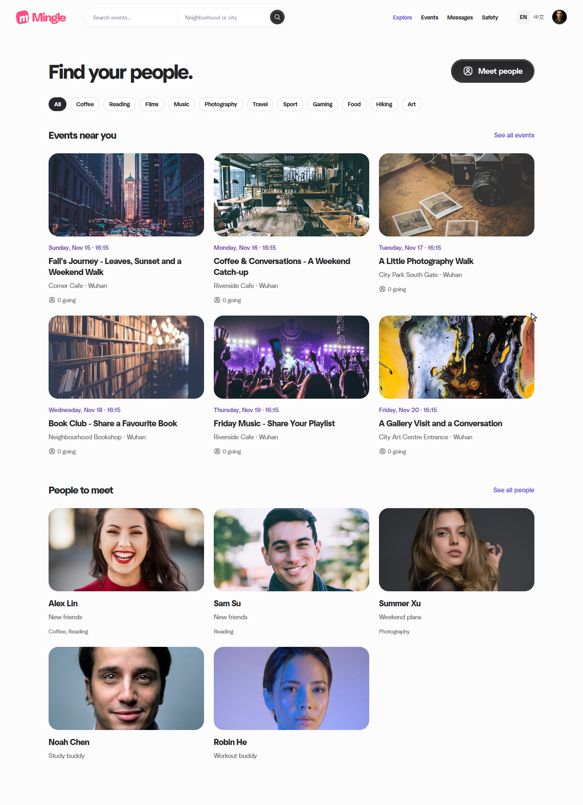

# Reference UI and Team Ownership - 13 November 2026

This revision publishes the approved reference-based interface and its final small polish. The event detail sidebar stays within its own content row, the bottom action bar reserves space, and the Meet people entry is larger. The optional local content library supplies 18 activity covers and 28 fictional profiles with portrait photographs. Card, detail and dialog transitions respect reduced-motion settings; sound remains off initially.

The Java/Spring Boot/Thymeleaf application now includes an event and people feed, event search and creation, personal attendance and saves, and text/emoji/sticker messaging. It preserves C's password-change contract, D's unread/history implementation, E's restricted report review and F's backup/restore tools from main. The reference-site layouts and asset sources are documented in [the experience review](../EXPERIENCE_REVIEW.md) and [the third-party record](../THIRD_PARTY.md).

## Ownership

Qin Tian is Scrum Master and Lead Developer, and the primary technical contributor. Qin Tian and Tao Jiacheng both participated in topic selection; Tao Jiacheng is Product Owner. The other four members are Developers. A's baseline and current interface work used Codex assistance. The [contribution record](../../../../team-plan/15_contribution_and_ownership.md) distinguishes actual increments from assigned work. Zhou Ziyue's [six-hour reliability follow-up](../../../../team-plan/tasks/week3/D_chat_reliability.md) is pending implementation.

## Verification of the integrated application

The code was integrated with main at `e8d14813b8cef985f9e6cef8976d3395ff59e221` before these checks. All processes below completed with exit code 0. The successful package and browser runs cover the final functional changes; subsequent edits only update documentation and trim trailing whitespace.

| Check | Result | Scope |
|---|---|---|
| Java 21 / Maven package | 66 tests; no failures, errors or skips | Account/session, discovery, permissions, events, fixture preservation, unread/history and persistence regressions |
| Reference browser runner | 7 groups passed | Two independent accounts, mutual likes, text/emoji/stickers, events, native forms, responsive layouts, motion preferences and browser/runtime errors |
| Conversation browser runner | 10 groups passed | Recipient-owned unread state, bounded history, poll/history overlap, keyboard send, long messages, mobile layout and ended-connection denial |
| PowerShell runtime runner | F-01 to F-04 and F-06 passed | File-fixture backup/restore, syntax, invalid-input rejection and handover documentation |

The runtime runner used `-SkipBuild -KeepArtifacts`: its F-05 Maven invocation was skipped, and Java coverage comes from the separate 66-test package run. Its backup/restore fixtures are fictional text records; this does not claim an additional real-H2 restore exercise. Browser accounts and databases were isolated from the preserved 8082 preview. See the [portable verification record](2026-11-13-verification.json) for suite names and actual assertions.

These are local automated checks. They do not establish independent teammate review, real-user research or a public deployment. Earlier 64-test and small-polish runs in the experience notes describe the pre-integration preview and remain separate evidence.

## Screenshot

The image below is the actual English-default Explore page from the integrated reference-browser run. The temporary language switch remains available during development. It was opened and visually checked before inclusion.

