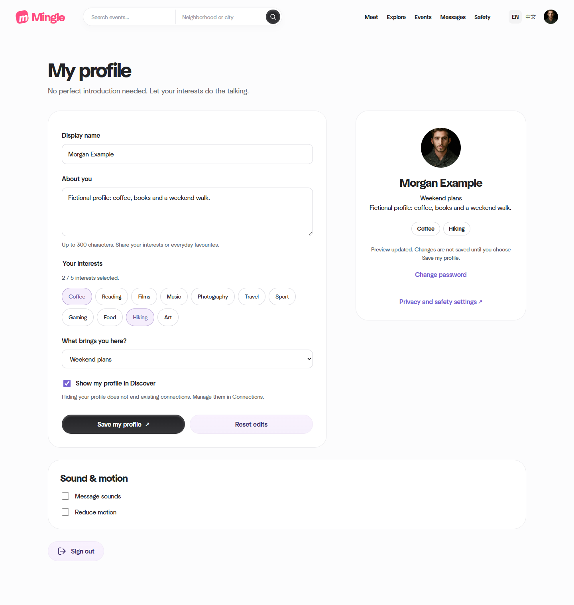

# Integrated local verification — 14 November 2026

The local project now includes merged PR #16 at main `7764f0eb3ecd3465f264fdf80b0fe92e13aaa751`. All 66 Java tests, 40 browser assertion groups, four real-H2 recovery groups and six backup-tool groups passed. One duplicate Maven invocation inside the backup-tool suite was intentionally skipped. Codex ran these checks; this record does not establish independent teammate review or product acceptance.

## Tested version and synchronization

The sync changed 43 files and checked 224 tracked source, script and build inputs against main. Previously replaced files were backed up under the local sync record (`.local/sync-backup/20261114-main-7764f0e/manifest.json`, retained locally). Existing planning changes, original captures and runtime databases were retained. The local coursework folder does not have Git metadata; the profile runner reports that fact and records source hashes instead of inventing a commit ID.

The executable JAR SHA-256 is `e8b0f07d8702842b43e938ff6735c4805d30480ba696c361714c7b116edc22fe`. The application Java/templates/assets were unchanged after the successful build. The later changes are the scripts listed below and documentation. 194 source hashes recorded by the profile run still match. The [structured record](./2026-11-14-verification.json) contains checks, script hashes and raw-result locations.

## Results

| Check | Final result | What it covers |
|---|---|---|
| Java package and tests | 66 passed, 0 failures/errors/skips; exit 0 | Account, language, discovery, matching, conversation/read state, events, safety and integration |
| Profile browser | 7 groups passed; exit 0 | PR #16 live preview, explicit saving, five-interest limit, keyboard focus, safe text, mobile layout and no-JavaScript fallback |
| Shared interface browser | 7 groups passed; exit 0 | Home, event filtering/creation/RSVP/saves, two-account messaging, native forms, account/safety layout and assets |
| Conversation browser | 10 groups passed; exit 0 | Unread ownership, later acknowledgements, more than 100 messages, history/poll merging, long text, keyboard, empty state and ended-contact rejection |
| Discovery browser | 16 groups passed; exit 0 | Filters, short/committed swipes, duplicate input, mutual match, correct chat, history return, no-JavaScript and hidden/ended-contact recovery |
| Real stopped-H2 recovery | 4 groups passed; exit 0 | Create real saved state, stop, checksum/backup/restore, start without seeding, verify retained logins/profile/connection/message and account-specific event save |
| Backup-tool checks | 6 passed, 1 skipped; exit 0 | Fixture copying, checksums, corrupt/unsafe/occupied input refusal, documented commands and Windows PowerShell UTF-8 compatibility |

Browser checks used Edge 157.0.4341.46, Playwright 1.62.1, Node v24.16.0 and Temurin JDK 21.0.12.1. They used temporary ports and separate fictional databases. Widths and touch were emulated. The previously running demo on port 8082 was preserved and was not refreshed by these runs.



Original PNG from the successful profile-browser run. The fictional nickname, bio, goal and interest choices update locally before explicit Save. This is an automated verification capture, not a user-taken screenshot or a real participant observation.

## Defects found and corrected

| Finding | Change | Retest evidence |
|---|---|---|
| Windows PowerShell 5.1 read a UTF-8 backup manifest using its default encoding. A Chinese source path made the JSON invalid and blocked restore. | `scripts/restore.ps1` reads the manifest and hash file explicitly as UTF-8. | New F-07 compatibility case and all four real-H2 groups pass. |
| The profile runner stopped in a normal coursework/source folder without `.git`. | Git metadata becomes nullable, while JAR/source hashes and the reason remain recorded. | All seven profile groups pass in this folder. |
| The shared-interface runner required exactly one stylesheet, conflicting with PR #16's additional profile stylesheet. | Check for the intended shared stylesheet, allowing the page-specific sheet. | All seven shared-interface groups pass. |
| The backup suite displayed a skipped Maven invocation as passed. | Record SKIP explicitly and count passed/skipped separately. | Six executed groups pass, F-05 remains SKIP. |

The new `scripts/tests/run-h2-restore-check.mjs` verifies actual H2 restoration in addition to fixture-byte checks. It also clears the inherited PowerShell module path for its Windows PowerShell subprocess. Initial sandbox networking failures and the failing first attempts remain in the local evidence directory. They are not counted as passing checks.

The corrupt-payload test now asserts that restore throws `Size mismatch`, and temporary fixture cleanup is bounded to its resolved task directory. The final tool retest passed six checks with one explicit build skip. [Final tool retest](./evidence/2026-11-14/backup-publication-retest.log).

## Read the actual logs

Published log/result copies normalize machine paths; original bytes and hashes remain accounted for in the [evidence manifest](./evidence/2026-11-14/manifest.json). Results and earlier failures are preserved.

- [java-build.log](./evidence/2026-11-14/java-build.log)
- [profile-original.log](./evidence/2026-11-14/profile-original.log)
- [profile-outside.log](./evidence/2026-11-14/profile-outside.log)
- [reference-outside.log](./evidence/2026-11-14/reference-outside.log)
- [reference-retest.log](./evidence/2026-11-14/reference-retest.log)
- [conversation-outside.log](./evidence/2026-11-14/conversation-outside.log)
- [discovery-outside.log](./evidence/2026-11-14/discovery-outside.log)
- [backup-retest.log](./evidence/2026-11-14/backup-retest.log)
- [real-h2-retest.log](./evidence/2026-11-14/real-h2-retest.log)
- [real-h2-fixed.log](./evidence/2026-11-14/real-h2-fixed.log)

The original `browser-summary.json` records the first reference-browser failure. The later `reference-retest.log` and its linked structured result supersede that outcome; the earlier file is retained unchanged.

## Reproduce

Run from the project directory using JDK 21. The profile runner has a pinned package lock under `scripts/profile-browser`; install that runner's dependencies with `npm ci` and use the documented Playwright/browser settings. No Node build is needed for the website itself.

```powershell
.\scripts\build.ps1
node scripts/profile-browser/run-profile-check.mjs
node scripts/reference-browser/run-reference-check.mjs
node scripts/conversation-browser/run-conversation-check.mjs
node scripts/browser/run-discovery-check.mjs
.\scripts\tests\BackupRestore.Tests.ps1 -SkipBuild -KeepArtifacts
node scripts/tests/run-h2-restore-check.mjs
```

For an existing local Edge install, set `MINGLE_BROWSER_PATH` to its executable. The shared runners and H2 runner accept `MINGLE_PLAYWRIGHT_MODULE` as a file URL to the installed Playwright module. Set `JAVA_HOME` when Java is not on PATH. The new H2 runner uses Windows PowerShell by default and accepts `MINGLE_POWERSHELL_PATH`. Existing runners' READMEs contain their remaining setup options.

## Remaining improvement and acceptance work

1. D: give a logical message send a persistent idempotency key and verify the lost-response/retry case. Current successful polling and history tests do not establish that retrying a committed send cannot duplicate it.
2. B/C: observe genuine participants using profile/discovery/events/chat, select changes from the observed findings and record a retest. B also supplies independent review of A's work.
3. E/F: reproduce permissions/recovery on the agreed release and a separate setup. F's independent reproduction remains distinct from Codex's automated restore exercise.
4. C/A: accept the final scope, run the real review/retrospective, prepare the demonstration and write individual reflections from actual experience.

The [design and planning pack](../design/README.md) maps ten figures to current code. [Trello](https://trello.com/b/j4LiifAK/mingle-team-kanban) carries six weekly indexes plus the seven member/team cards. The fixes, normalized evidence copies and design/plan pack are included together in this release change. The PR and CI records establish publication status.
