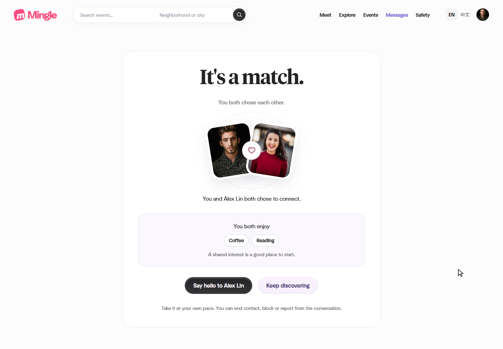

# Five motion effects

Date: 14 November 2026. Implemented with Codex assistance at Qin Tian's request.

This release adds all five selected motion effects to the existing Mingle interface. GitHub PR and CI records establish publication status; [the team board](https://trello.com/b/j4LiifAK/mingle-team-kanban) tracks follow-up acceptance.

| Effect | Actual trigger |
| --- | --- |
| Magnetic profile card | Pointer movement tilts the portrait; a short drag springs back. A committed swipe retains the existing single-submit behavior. |
| Mutual-match cards | The two participants' cards converge and the heart appears on a real, authorized match page. |
| Chat bubble arrival | Confirmed new messages enter from their sender's side. History loading and duplicate polls do not replay the effect. |
| Save particles | A brief burst follows the server-confirmed saved state. Refresh, unsaving and a denied save do not produce a success burst. |
| Staggered entry | Visible event/profile cards and conversation rows enter in a short sequence. |

Both the system reduced-motion preference and the existing in-app setting suppress the effects. Content and native forms remain usable without JavaScript. Failed native POST navigation does not attempt a cross-document transition into an unsupported error page.

## Reproduce and inspect

Use the [application setup](../../README.md) and [portable motion runner](../../scripts/motion-browser/README.md). The runner creates a new loopback-only database and fictional accounts; it does not operate on the shared preview. The current source files and evidence links are recorded in [the verification record](./2026-11-14-motion-verification.json).

## Verification

- JavaScript syntax checks and Maven packaging passed. Local packaging explicitly skipped Java tests; no new local Java test run is claimed.
- The existing reference suite passed all 7 groups, covering real saves, reciprocal likes, text/emoji/stickers and JavaScript-free forms.
- Discovery passed all 16 groups after the pointer-release correction, including mouse, emulated touch, keyboard, duplicate submission and stale-card recovery.
- Final motion inspection passed all 7 groups: observed stagger timing and spring overshoot, 390/320 px match-animation bounds, sender/receiver arrival, no empty-poll replay, denied-save feedback and both reduced-motion settings.
- The portable runner passed the same 7 groups against the recorded JAR hash. Four live JavaScript/CSS assets also matched the final source bytes.

The first inspection found a 20 px transient match-card overflow at 320 px. Narrower entrance travel fixed it. Inspection also exposed an interrupted spring on implicit pointer release and a page-transition rejection on a bare denied-save response. Both were repaired and rechecked. [Original failures and successful retests](./evidence/2026-11-14-motion/README.md) remain available with normalization and hash provenance.

Browser evidence is automated Edge verification, not a student's manual capture or independent teammate review. Real-user acceptance and peer review remain separate. The PR's Java and Windows recovery CI runs are additional checks with their own GitHub results.

## Actual preview captures

Unmodified PNG from the running fictional-account preview. A still image shows the resulting composition; the runner observes actual motion.

Unmodified PNG from the isolated browser check. The page scrolls vertically; the full animation was also checked for horizontal overflow.
