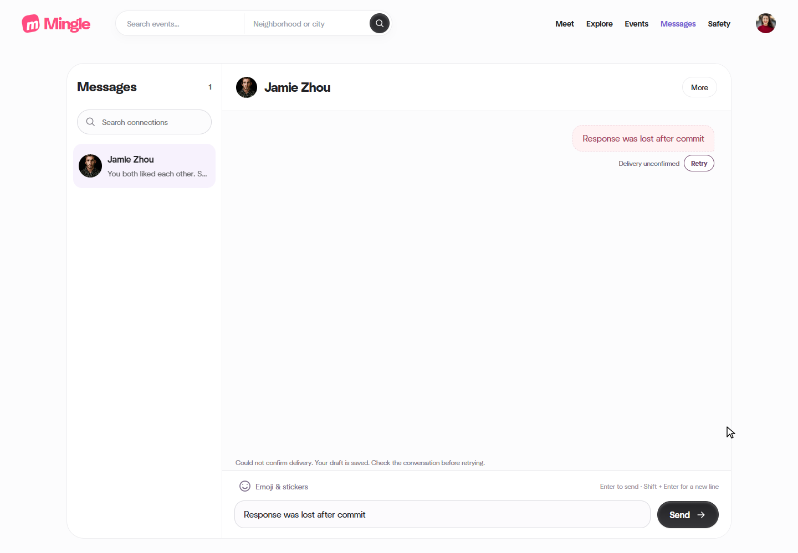
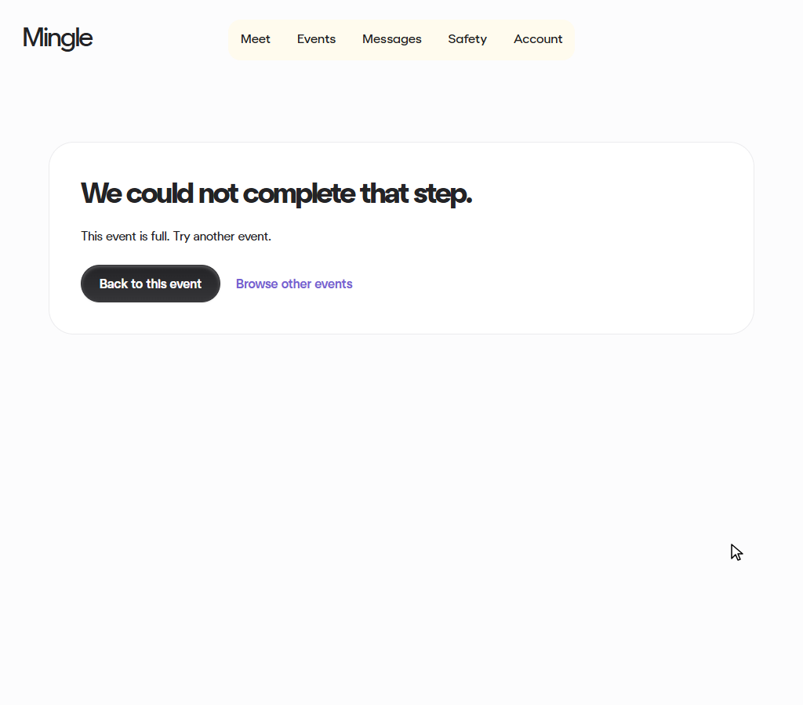

# A recovery increment — verification

Recorded 28 November 2026, Asia/Shanghai. **Operator: Codex automated checks for A.** This is a verified PR increment; Qin Tian retains review, merging and final integration. It is not the team's frozen release or B–F's acceptance.

## Revision and provenance

- Base main: `081597d5e2012ef078b2f42369446c7480e4b8f0`.
- Verified source and executable test scripts: `7d0bd297048ace4d1080c99e5230e7694e12b10c`. The later evidence commit adds only this report, its images/JSON and test instructions.
- Local verification JAR SHA-256: `fbfac88545abf1b56b44f9249d8ef2e45d0e0cb50b3ccd19dbbc355ddc365273`. This is a build identity, not a distributed team candidate. A later rebuild may have a different byte hash.
- Windows; Temurin Java 21.0.12.1+1; Node 24.16.0; Edge/Chromium 158.0.4370.45; separate fresh H2 databases and fictional accounts for every browser run.

The selected local patch was applied file by file to current main. Its CSS would have removed B's `min-width:0` from the inbox; that regression was excluded. D's existing idempotent server send and late-response handling remain the basis of the chat flow. No original demo database was opened or changed.

## Before and after

| Trigger | Previous behavior | Result in this increment |
| --- | --- | --- |
| Server commits a message but the acknowledgement is lost | “Not sent · Retry” was text, even though the message could already be stored | “Delivery unconfirmed” and a native keyboard-operable Retry button; the same logical identity is reused |
| A failed sticker is retried while an unrelated draft is edited | The draft and pending sticker identity could interfere | Retry sends the original sticker and preserves the edited draft |
| Polling confirms before the original POST finishes | A late response could interact with a newly initiated send | The in-flight request keeps its send lock; confirmation does not revert to failure |
| A stale event page tries to fill the final place after another account | Generic discovery recovery | Local links back to the same event and to the event list; cancellation allows a replacement attendee |
| Homepage describes a dating product | Reference dating copy remained | Shared-interest friendship copy in both development languages |
| Tablet viewport hides the header language switch | No accessible language entry at that width | Development account menu includes it; final English mode omits language links entirely |

## Results

| Check | Actual result |
| --- | --- |
| `./scripts/build.ps1` | Exit 0; 79 Java tests, 0 failures, 0 errors, 0 skipped |
| Retry browser suite | Exit 0; 11 checks including keyboard Retry, one stored message, unread count, changed draft/new identity, late failure, sticker/draft isolation, rejection and access loss |
| Recovery browser suite, final English | Exit 0; 5 checks; Chinese query/browser preference cannot change the interface; all 18 new event titles, descriptions and locations are English |
| Recovery browser suite, development mode | Exit 0; 5 checks; tablet language entry changes language; capacity recovery and inbox checks also pass |
| Visual inspection | Native PNGs below inspected; retry label/button and recovery links are readable |

Commands and setup are in the [reproduction instructions](../../scripts/recovery-browser/README.md); individual assertions and timestamps are in the [machine-readable record](./2026-11-28-a-recovery-verification.json). The Java final-language check also starts with an existing Chinese session and validates English error messages.

Figure 1. Automated Edge capture on 28 November. The message was committed, its response was deliberately dropped, and polling was held for observation. Clicking or pressing Enter on Retry subsequently confirmed exactly one stored message. Fictional accounts; this is not a human usability session.

Figure 2. Automated Edge capture on 28 November from the third account's stale event page. After another account cancelled, the third account joined and total attendance remained two.

## Remaining decisions

- Qin Tian reviews and merges this PR, chooses the combined candidate and distributes its commit/JAR/configuration.
- B's real observation/review, C's product decision, D/E's candidate checks and F's independent reproduction remain their work. These automated checks do not sign them off.
- New demo seeds are English. Existing user/database text is intentionally preserved; the selected final demonstration database still needs an owner decision and check.
- Existing third-party assets and fonts are unchanged. E/C's itemised provenance/use assessment and A's resulting decisions remain pending.
- Final video, shared MMUTube access, personal reflection and Moodle submission are pending. No grade or final acceptance is claimed.
