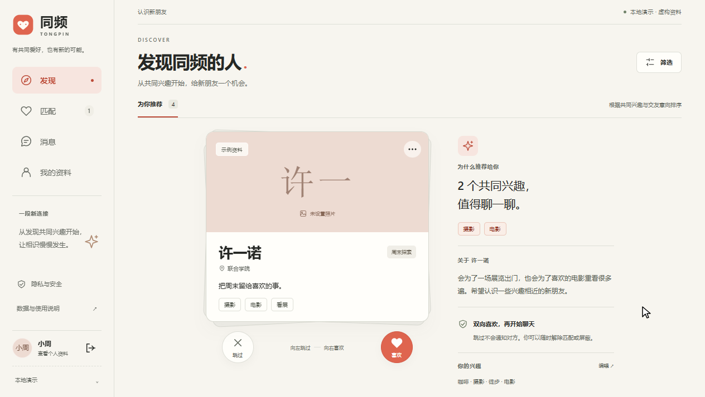
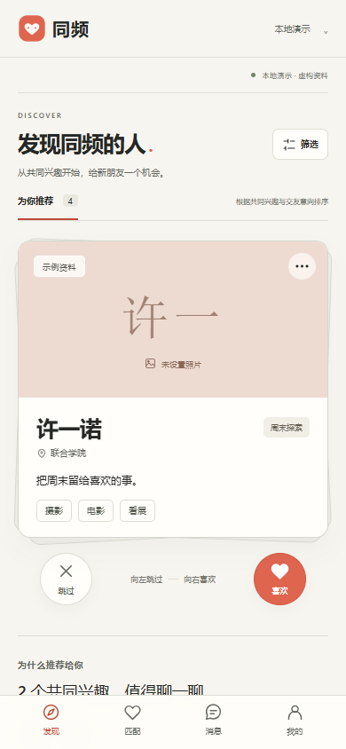
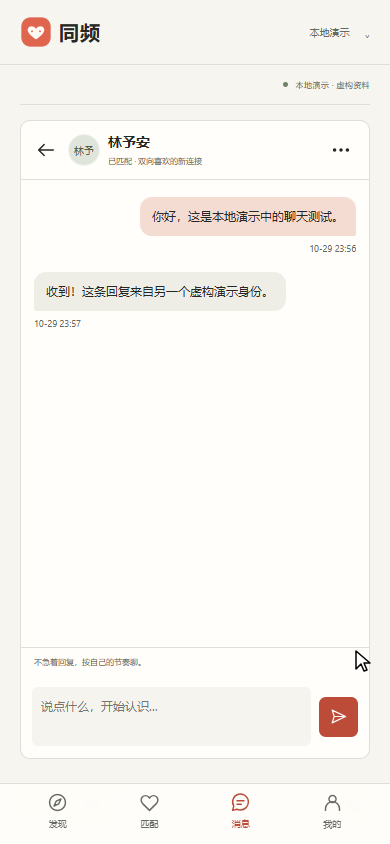

# 第一版验证记录

验证时间：2026-10-29 至 2026-10-30。本轮针对本地原型，使用虚构资料；不是正式用户研究或生产验收。

## 自动检查

| 检查 | 结果 | 证据 |
|---|---|---|
| Django 功能测试 | 25/25 通过 | [完整测试输出](./test-run.txt)，`social/tests.py` |
| Django 系统检查 | 0 个问题 | 上述测试输出末尾 |
| 数据模型与迁移一致性 | `No changes detected`，退出码 0 | `manage.py makemigrations --check --dry-run` |
| JavaScript 语法 | 退出码 0 | `node --check static/app.js` |
| 首页 HTTP | 200 | 本机 `http://127.0.0.1:8765/` |

测试覆盖注册成年声明和密码哈希、资料验证、隐藏资料、兴趣筛选与排序、单向／双向喜欢、重复匹配、跳过恢复、聊天收发及游标、空白／超长输入、HTML 转义、第三人访问拒绝、屏蔽、解除、取消屏蔽后不恢复、举报可见性、CSRF、只允许 POST 的状态操作，以及演示身份边界和种子数据的幂等性。

这些测试使用内存数据库，不会清空本机演示记录。并发压力、端到端加密和生产安全未通过这些测试得到证明。

## 浏览器实际操作

在 Codex 内置浏览器执行并观察：

1. 首页进入小周演示身份，出现推荐及共同兴趣。
2. 喜欢已经喜欢小周的林予安，进入匹配成功页。
3. 进入聊天，发送一条明确标为本地测试的消息。
4. 切换林予安身份，从消息列表读到消息并回复。
5. 在 390 × 844 手机尺寸检查聊天和发现页面。
6. 选择“阅读 + 运动搭子”，出现空状态；清除后恢复推荐。
7. 在手机“我的资料”找到并打开隐私与安全入口。
8. 恢复默认桌面尺寸并保留预览页。

独立 Edge 截图流程另行保存了 1264 × 713 桌面和 390 × 844 手机的真实 PNG。两者是不同浏览器会话，共用本地演示数据库；未复制浏览器登录信息。桌面截图流程检查到页面没有横向溢出，手机画面已目视检查主要控件可用。未进行完整键盘／屏幕阅读器审计，未测试真实手机软键盘或 Safari。

## 本轮修复

- 缩短笔记本首屏留白和头像占位高度，使喜欢／跳过操作在首屏可见。
- 手机保留可滚动查看的共同兴趣解释，避免仅在桌面显示。
- 在资料页补齐账号与安全入口，手机可直接进入安全设置或退出。
- 限制举报入口对陌生隐藏资料的访问；已建立联系的人在屏蔽后仍可举报。

## 实际页面

下图为真实本地发现页，使用文字头像和虚构资料。人物照片按当前要求暂缓。

手机发现页：主要操作在首屏，说明内容可继续向下查看。

手机聊天页：两条消息来自切换后的两个虚构身份，保存在本地数据库。

文档中的三张图片使用同目录 `images/` 相对路径，已在 marked + Microsoft Edge 实际渲染，3/3 加载成功；这不代表已检查所有本地 Markdown 编辑器。

## 下一轮验收重点

真实任务测试、照片方案、数据导出与删除、账号恢复和限流、审核职责、部署及恢复演练。指针拖动与键盘入口已有实现，尚未完成跨设备手势验收；本轮浏览器主要验证按钮与表单流程。
