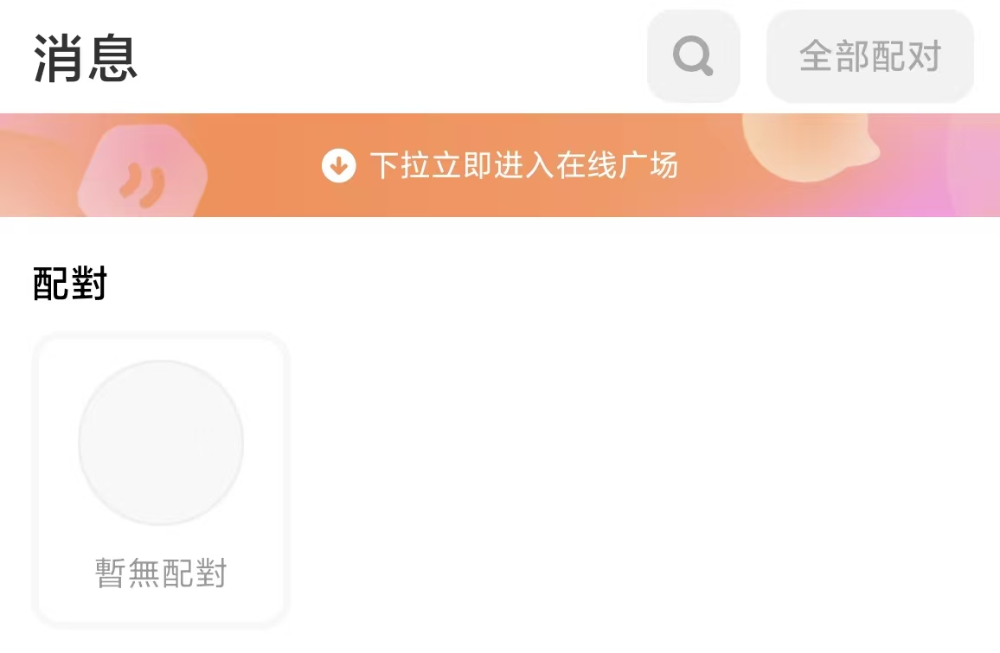
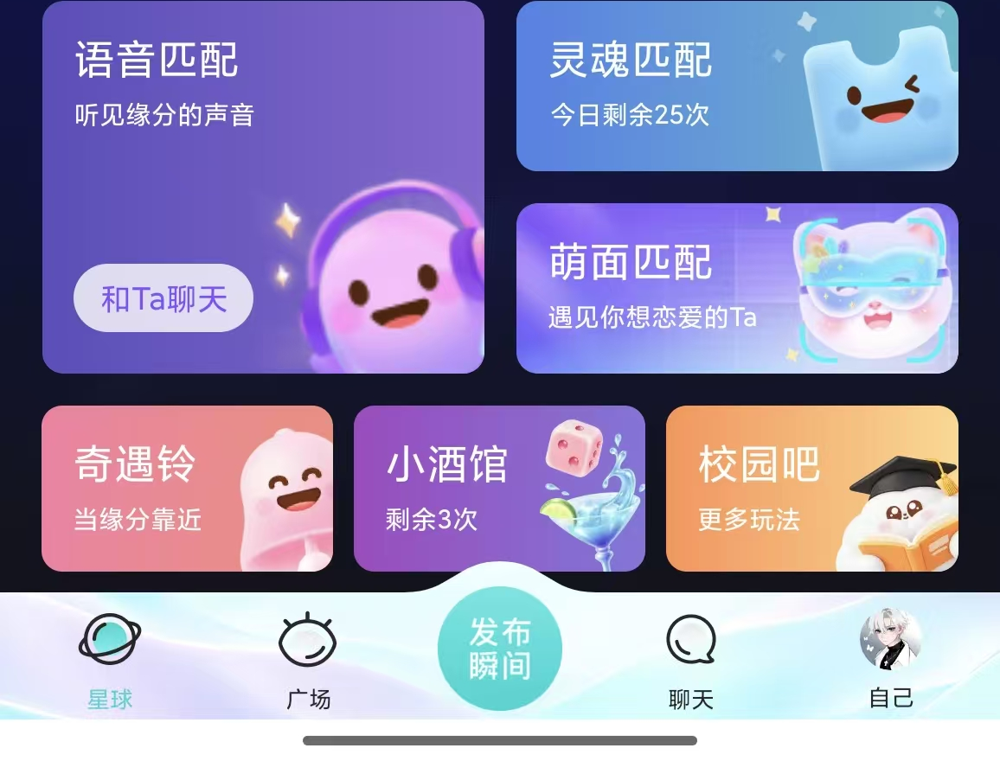
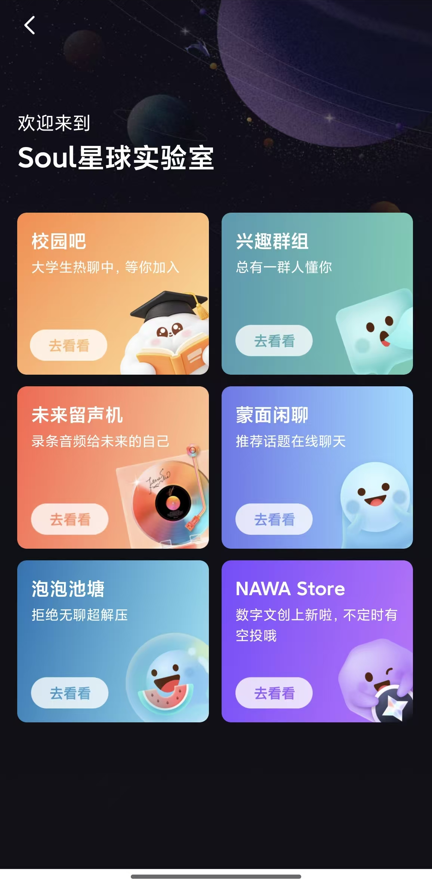

# W1 Interface and Navigation Research

Member: B (Ziyue Zhou)
Research date: November 6, 2026
Reviewer: C

## Sources and Method

This study compares Tantan's card-based matching with Soul's interest-led discovery and broader social features.

- **Tantan:** [website](https://tantanapp.com/) and [China App Store](https://apps.apple.com/cn/app/id861891048).
- **Soul:** [website](https://www.soulapp.cn/) and [China App Store](https://apps.apple.com/cn/app/id1032287195).

I reviewed the public product pages and supplied iOS interface captures. I did not create an account, test live matching, use paid features, or contact users. The Tantan card image is a public promotional image; the others are interface captures. Personal names, portraits, and conversations were removed or avoided.

## Evidence

### Tantan discovery card

The portrait dominates the screen. Rewind, skip, like, and super-like actions share one row. Like is the strongest action, while skip is secondary. This helps users recognize the main decision, although icon-only controls require prior knowledge. This promotional image does not prove live behavior.

### Tantan empty state

The message page retains its heading, search, match-list control, and online-area banner. The match section shows an explicit empty tile rather than a blank area. The crop does not show what happens after tapping a control.

### Soul discovery and navigation

The bottom navigation has five labeled destinations and an emphasized center action. Several matching cards appear above it with different visual weights. Navigation is clear, but the number of choices may slow first-time users.

### Soul secondary page

A back arrow replaces the bottom navigation on this secondary page. Six feature cards use the same title, description, and action-button pattern. The page level is clear, but all six destinations have similar importance.

## Comparison

| Point | Tantan | Soul | Implication |
|---|---|---|---|
| Navigation | Discovery and messages are separated into task areas. | Labeled bottom navigation supports orientation; the back arrow marks a secondary page. | Keep first-level navigation stable and make return paths explicit. |
| Primary actions | Matching decisions are grouped and differentiated. | Matching methods appear as several cards without one dominant choice. | Limit simultaneous primary actions. |
| Mobile layout | One person receives most of the attention. | Several features compete on one screen. | Prioritize the profile and one next action. |
| Empty and error states | An explicit no-match state is visible. | No empty or error state was observed. | Design actionable empty and retry states. |

## Design Takeaways

**Two practices worth adopting:**

1. **Use a clear action hierarchy.** Tantan gives like stronger color and size than skip, making the main decision easier to identify.
2. **Explain an empty state.** Tantan names the missing content instead of showing a blank region; the message should include a useful next step.

**One practice not to adopt:** Do not give six unrelated secondary features equal visual weight in the first release. Soul presents campus, groups, voice messages, anonymous chat, relaxation, and a store as similar cards. The grid is consistent, but it does not help new users identify the core task. Prioritize discovery, matching, and messaging.

## Three Interface Recommendations

1. **Keep five first-level destinations in a bottom navigation bar, using icons and text.**
   Basis: Soul makes the current section and destinations recognizable without requiring users to remember icon meanings.

2. **Make like primary and skip secondary, with short labels or first-use guidance.**
   Basis: Tantan's hierarchy is clear, but icon-only controls may still require prior knowledge.

3. **Use an explicit empty state with a next action, plus a retry state for failed loading.**
   Basis: Tantan shows a named empty state, while no error state was observed. Neither case should leave a blank screen.

## Candidate User Story

As a mobile user, I want to recognize the main action on the discovery screen and know what to do after a match, so that I can move from browsing to conversation without confusion.

### Acceptance Criteria

1. When discovery loads, like and skip are visible without scrolling and have labels; after selecting like, the next profile appears and clear feedback is shown.
2. When no recommendation is available, the page shows an explanation and an action that opens preference settings; it does not remain blank.
3. When a match is confirmed, a success message provides a primary chat action and a secondary continue-browsing action; chat opens the conversation.
4. When recommendation data fails, the page shows an error and a retry action; retry starts a new request without losing context.

## Discussion Questions

- Should the first release prioritize fast card-based matching or interest-led discovery?
- Which three primary paths should remain visible in the first version?
- Which secondary features should wait until matching and messaging are validated?
