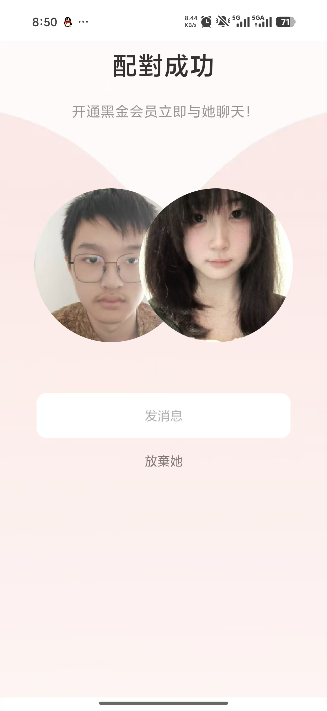
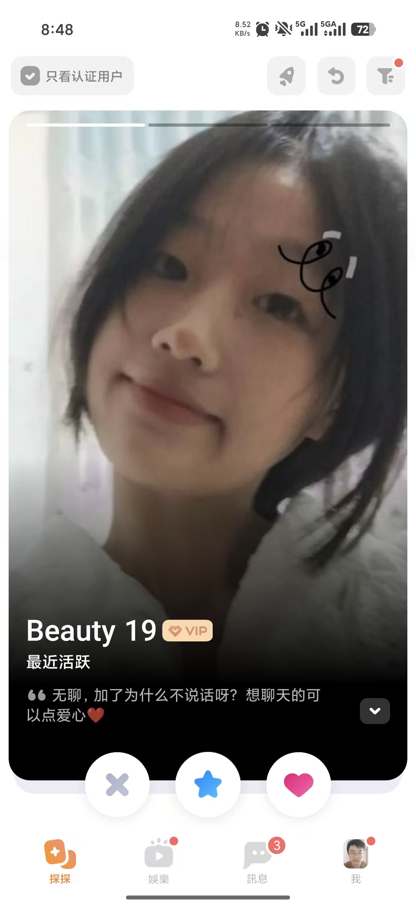
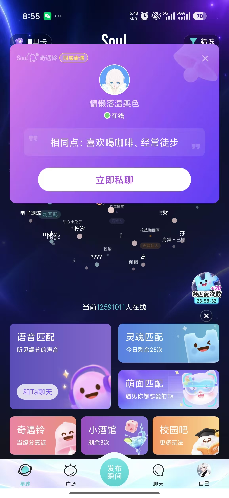

# A Qin Tian: Discovery Cards, Match Feedback and Integration

Owner: **Qin Tian (A)** · Reviewer: **B Wang Yikai** · First feature target: **11 November 2026**. Internal dates are estimates. Use the merged baseline on current main, or this dated source snapshot; confirm shared contracts before overlapping edits.

[Run the project](./RUN.md) · [Six test scenarios](./TESTS.md) · [Team map](./TEAM.md) · [Photo and evidence plan](./EVIDENCE.md)

## What is already there

Filtering, drag/button decisions, mutual matching and basic chat already work. The included code is A's AI-assisted baseline. Your contribution is the increment below.

## Build this

1. Refine the large discovery card, visible filter summary and useful empty-result actions.
2. Add or improve mutual-match feedback with a clear action opening the correct conversation. Show only genuine shared interests.
3. Preserve the same validated action for mouse, emulated touch, keyboard and buttons; keep reduced motion usable.
4. Agree account/session, read-state, staff-role and data-path contracts with the module owners before shared edits.
5. Review the five incoming modules, integrate accepted PRs and resolve shared integration failures with their owners.
6. Lead CORE-01–08 acceptance, consistent error/recovery behaviour and the final English interface check.
7. Coordinate product evaluation, the demonstration narrative and final handover with B/E/F; each member writes their own reflection.

**Current status:** the first filter/match increment is implemented on w2/a-discovery and locally verified with 31 Java tests and 11 browser groups. The included source remains the merged 19-test baseline snapshot; see [A's published evidence](https://github.com/hansu650/thematic-friend-finder/blob/w2/a-discovery/code/thematic-friend/docs/progress/week2/A_progress.md) for the increment. Independent review and the remaining integration work are pending.

A owns the existing AI-assisted baseline and the extra coordination/integration work. B reviews A. Do not implement the reserved B–F increments on their behalf.

## Start in these files

All paths below are inside the included project.

- [src/main/resources/templates/discover.html](./code/thematic-friend/src/main/resources/templates/discover.html)
- [src/main/resources/static/js/app.js](./code/thematic-friend/src/main/resources/static/js/app.js)
- [src/main/resources/static/css/app.css](./code/thematic-friend/src/main/resources/static/css/app.css)
- [src/main/java/com/example/thematicfriend/discovery/DiscoveryController.java](./code/thematic-friend/src/main/java/com/example/thematicfriend/discovery/DiscoveryController.java)
- [src/main/java/com/example/thematicfriend/discovery/DiscoveryService.java](./code/thematic-friend/src/main/java/com/example/thematicfriend/discovery/DiscoveryService.java)
- [src/main/java/com/example/thematicfriend/connection/ConnectionService.java](./code/thematic-friend/src/main/java/com/example/thematicfriend/connection/ConnectionService.java)

## Tests and screenshots to submit

Implement the six distinct behavior groups in [TESTS.md](./TESTS.md). Include the first three relevant scenarios with your first feature PR; complete the six groups and independently reproduce two peer checks by **22 November**. Reuse existing checks openly and identify your new assertions.

| Capture | What to show | Example filename |
|---|---|---|
| Normal result | Discovery card and genuine match-success result | A_normal.png |
| Boundary/error | No eligible candidates or a short drag returning without submission | A_boundary.png |
| Executable test result | Readable test names/results, command and source version | A_tests.png |

Use fictional data. Capture desktop and 390 px where a UI assertion requires it. Record expected/actual results and any remaining limitation in your own progress MD.

## Hand in

Submit your changed source and tests, real output, normal/boundary screenshots, a PR/check capture, an updated personal Trello card and **A_progress.md**. Follow [SUBMIT.md](./SUBMIT.md) for branch **w2/a-discovery**, [CAPTURE.md](./CAPTURE.md) for actual terminal commands and [FINISH_LINE.md](./FINISH_LINE.md) for final acceptance. The baseline was merged in PR #8; create a new task branch from current main, or continue your existing task branch without overwriting work.

Qin Tian has two code screenshots for explaining A's work. B–F do not need code screenshots; submit source/test files and a brief explanation in Markdown. Each member uses their own task package and captures.

## Your supplied UI references

These are the user's supplied reference screenshots, not screenshots of the implemented project. Some show Soul branding. Use layout/interaction ideas with the project's warm-white/coral style, English default and temporary language switch. Keep initials/gradients; profile photos remain deferred.

### Reference 3

Mutual-match feedback and primary conversation action.

### Reference 4

Large discovery card, visible filters and decision buttons.

### Reference 5

Shared-interest explanation; derive it from real stored interests.

