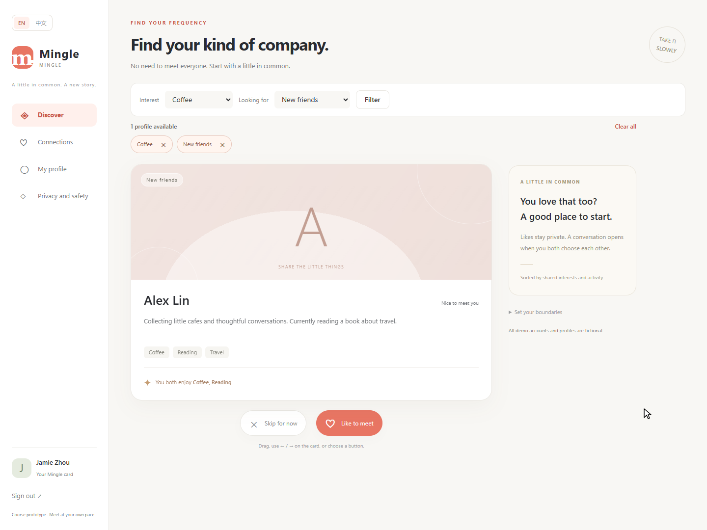
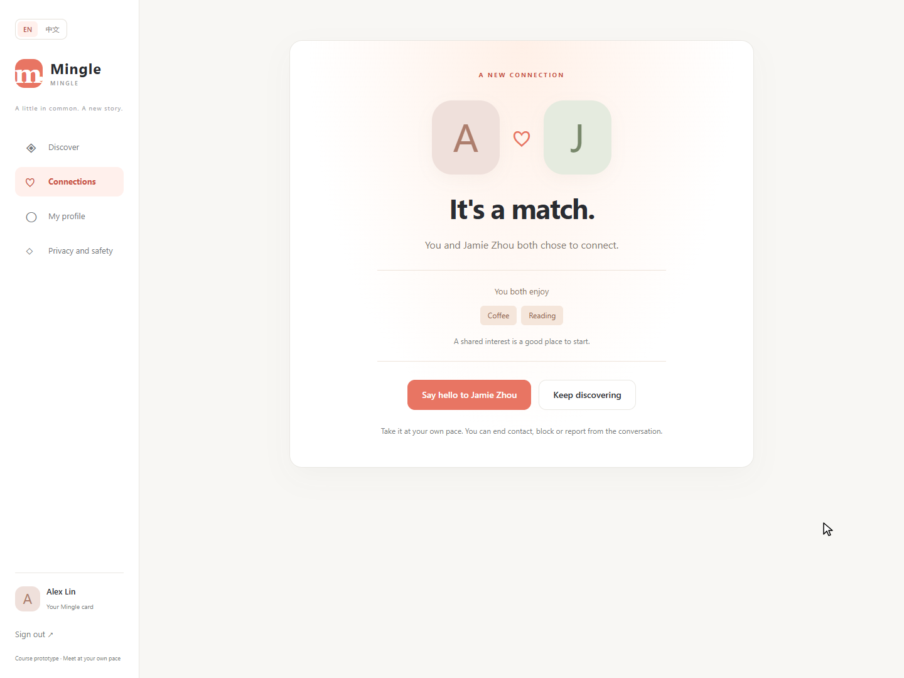

# A Qin Tian — Week 2 Progress

Date: **6 November 2026** · Branch: **w2/a-discovery** · Reviewer: **B Wang Yikai**.

Implementation and local verification: **complete for this increment**. Independent peer review: **pending**. Later member-contract agreements and integration: **pending actual team work**.

## Starting point and actual change

The baseline already handled registration, saved profiles, discovery ranking, like/skip gestures, mutual connections, basic chat and safety receipts. Those are retained baseline capabilities, not new work in this submission.

This increment adds a visible eligible-profile count and removable filter chips, preserves the other selected filter when one chip is removed, and gives empty results useful recovery actions. It counts only eligible skipped profiles before offering to revisit. It also adds a separate mutual-match feedback page with the actual participant, actual shared-interest intersection and a button opening that connection's conversation. The existing drag/button/keyboard submission mechanism is reused and checked.

## Code and integration

Changed implementation: DiscoveryController, DiscoveryService, new MatchController, discover.html, new match.html, app.css and both message bundles. Added tests: DiscoveryRegressionTests and the optional isolated browser runner. Exact paths/hashes: [changed-files.json](./evidence/changed-files.json). Full build inputs: [source-manifest.json](./evidence/source-manifest.json).

There are no entity/schema changes in this increment. The new GET /matches/{id} requires an active connection participant; third parties, anonymous requests and ended/blocked connections cannot read active feedback. POST decisions remain CSRF protected. D continues to own unread/history work, C account/session changes, E restricted report handling, B profile preview, and F backup/restore.

## What was verified

- **A-01:** filters, shared-interest truth, invalid-filter normalization and visible counts.
- **A-02:** exclusion rules and eligible revisitable profiles, including hidden users and blocking in either direction; the baseline self-exclusion tests remain included.
- **A-03:** one-sided likes, reciprocal likes and repeated server submissions using one connection.
- **A-04:** short/committed mouse and emulated-touch gestures, arrow keys and buttons; request counts checked in the browser.
- **A-05:** appropriate empty recovery, active participant-only feedback, actual shared interests, correct conversation and received message.
- **A-06:** 390 px and desktop layouts, temporary Chinese controls and reduced motion.

Java: **31 passed, 0 failures, 0 errors, 0 skipped; exit 0**. Browser: **11 groups passed; exit 0**. Details and original output: [TEST_RESULTS.md](./TEST_RESULTS.md).

## Real defect and retest

The first Java run reported two template-rendering errors. The chip aria-label evaluated a bean method inside a restricted message parameter. I changed the template to resolve translated labels with th:with first, then pass the resulting strings to the message expression. The same build/test command subsequently passed all 31 tests. [Original failure](./evidence/java-first-failure.txt) · [Successful retest](./evidence/java-retest.txt).

## Evidence, assistance and remaining work

These are screenshots of the running implementation and recorded tests with fictional profiles. Touch was emulated in Chromium; no physical phone or user study was conducted. [Evidence index](./EVIDENCE_INDEX.md).

Codex assisted implementation, regression tests, capture automation and this report. Baseline ownership is not unaided authorship. A should read the changed code and rerun the relevant checks before explaining it. B's independent review is still required; leave that checklist unchecked until B performs it. Future contract agreement, peer reproduction and integration records will be added from real activity. Actual human hours have not been supplied and are not invented here.
