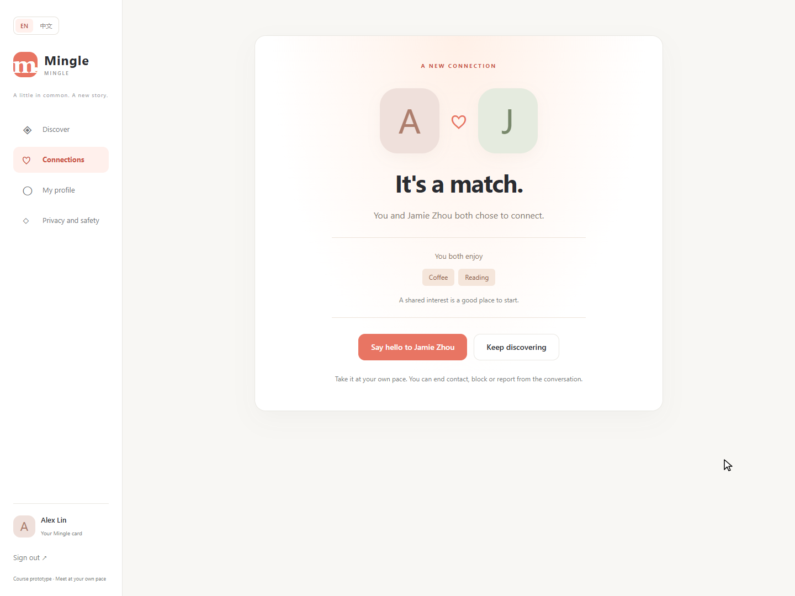
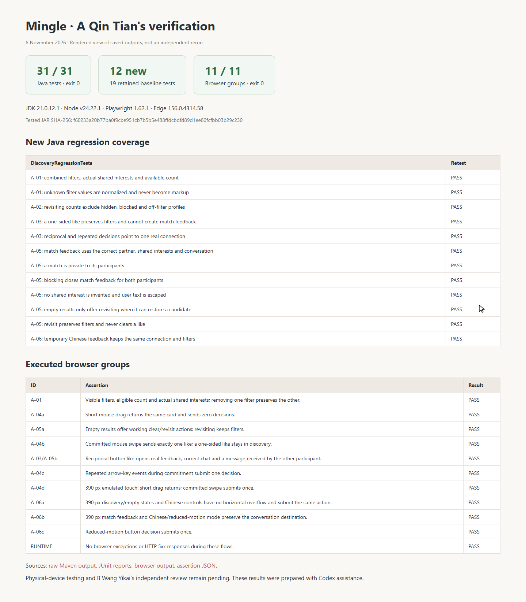
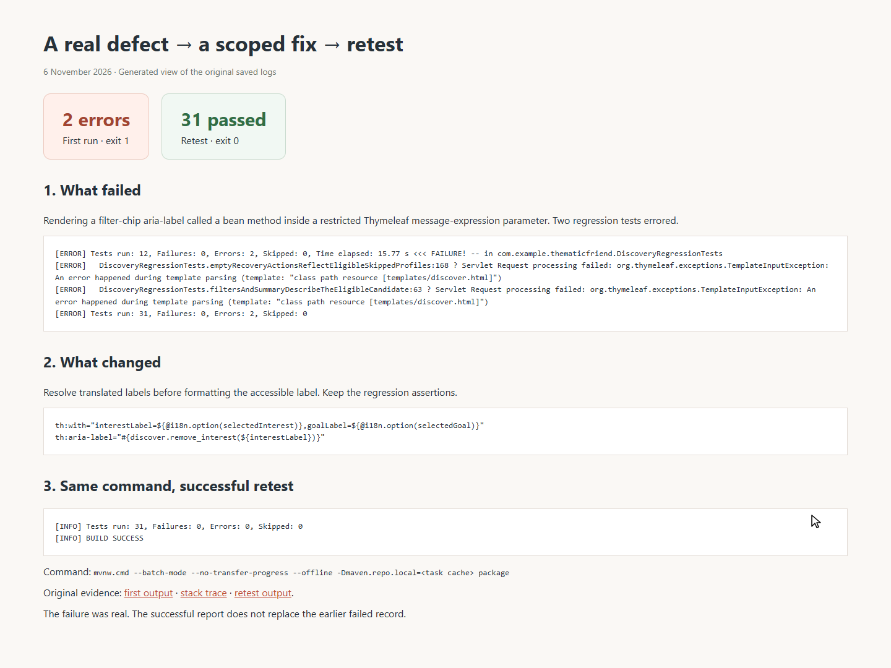

# A Qin Tian — Evidence Index

Captured on 6 November 2026. Product images are real isolated Edge captures of fictional data. The board image comes from the existing managed Edge session. Source/run identity is in [TEST_RESULTS.md](./TEST_RESULTS.md).

## Trello: work started

A moved into Doing before this implementation. Native managed-browser JPEG retained as captured.

## Before: baseline discovery

The preserved baseline JAR, same fictional user and Coffee/New friends filters. No count/chip summary yet.

## After: visible filters

Eligible count, removable chips and actual shared interests.

## Boundary: short drag returns

The same card after a short mouse drag. Zero submitted requests is verified by the script, not by this still image alone.

## Boundary: eligible skipped profile

The filtered result is empty; one eligible skipped profile can be restored.

## Boundary: no eligible candidate

Clear filters is offered; no ineffective revisit action is shown.

## Normal: reciprocal match

Only after both fictional users like each other. Real common interests and the correct participant are shown.

## Normal: correct conversation

The match action opened the correct conversation; the other session received the message.

## 390 px: discovery

Actual full-page capture of the emulated mobile layout.

## 390 px: match feedback

The correct conversation action stays available in reduced-motion mode.

## 390 px: temporary Chinese UI

The same validated actions are available after switching language.

## Reduced motion: discovery

A real page capture under reduced-motion preference; submission behavior is checked in the script.

## Executable test results

A rendered view of the saved JUnit/browser outputs; see [TEST_REPORT.html](./TEST_REPORT.html) and the original evidence files. This is not a screenshot of a teammate running the tests.

## Actual defect and successful retest

The first failure and successful retest are both retained. See [DEFECT_REPORT.html](./DEFECT_REPORT.html).

