# A Qin Tian — Evidence Index

Captured on 6 November 2026. Product images are real isolated Edge captures of fictional data. The board image comes from the existing managed Edge session. Source/run identity is in [TEST_RESULTS.md](./TEST_RESULTS.md).

## Trello: work started

A moved into Doing before this implementation. Native managed-browser JPEG retained as captured.

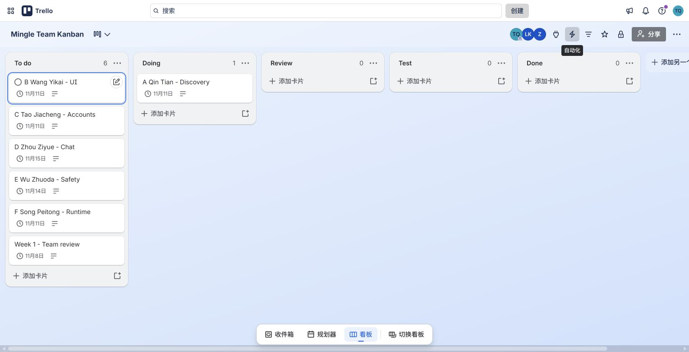

## Before: baseline discovery

The preserved baseline JAR, same fictional user and Coffee/New friends filters. No count/chip summary yet.

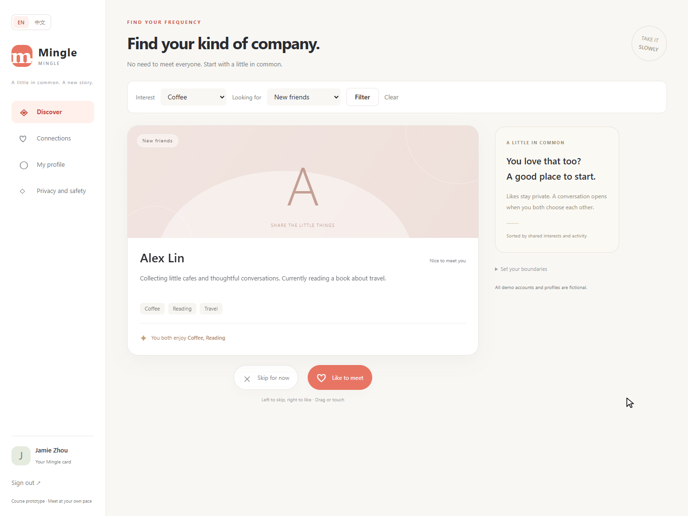

## After: visible filters

Eligible count, removable chips and actual shared interests.

## Boundary: short drag returns

The same card after a short mouse drag. Zero submitted requests is verified by the script, not by this still image alone.

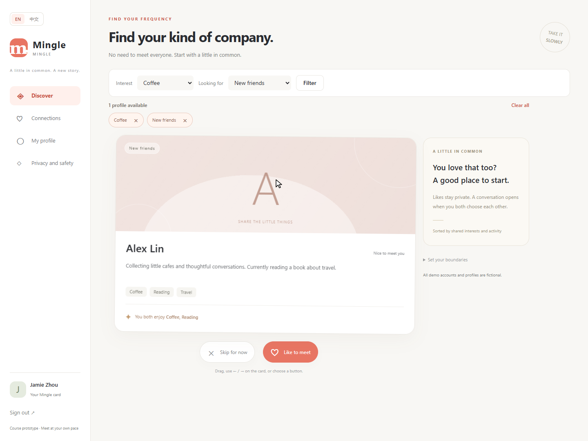

## Boundary: eligible skipped profile

The filtered result is empty; one eligible skipped profile can be restored.

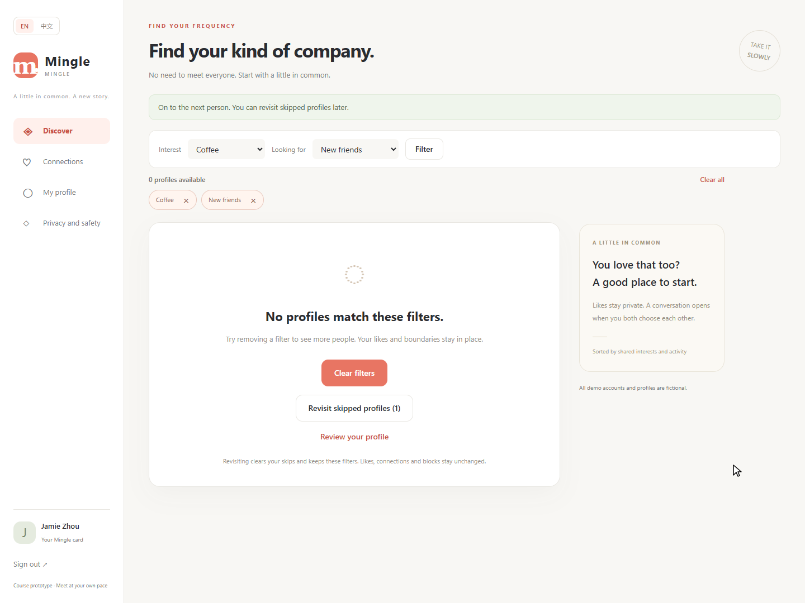

## Boundary: no eligible candidate

Clear filters is offered; no ineffective revisit action is shown.

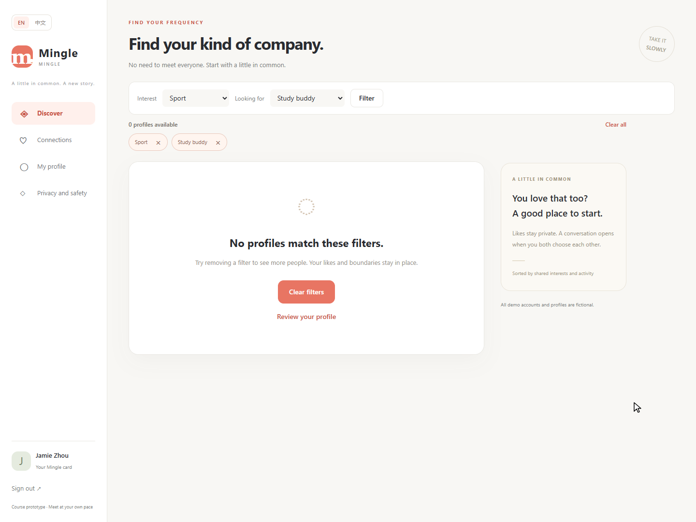

## Normal: reciprocal match

Only after both fictional users like each other. Real common interests and the correct participant are shown.

## Normal: correct conversation

The match action opened the correct conversation; the other session received the message.

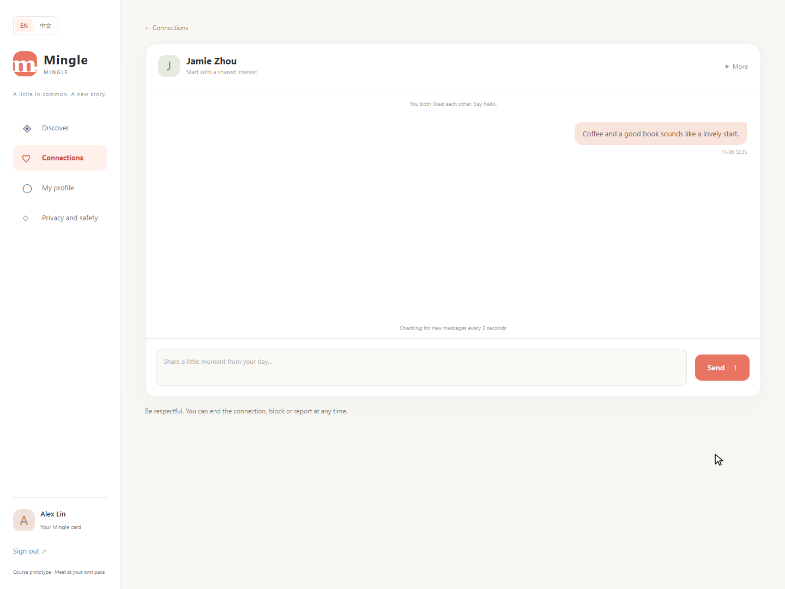

## 390 px: discovery

Actual full-page capture of the emulated mobile layout.

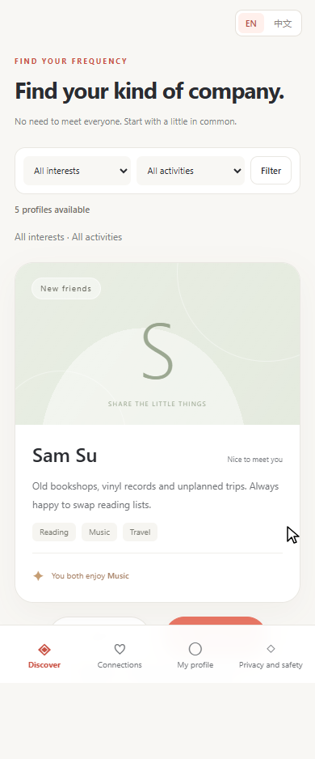

## 390 px: match feedback

The correct conversation action stays available in reduced-motion mode.

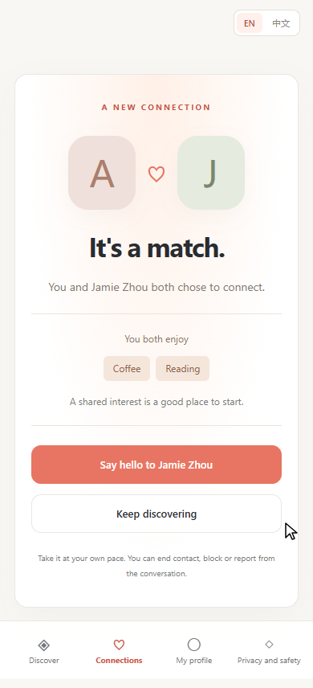

## 390 px: temporary Chinese UI

The same validated actions are available after switching language.

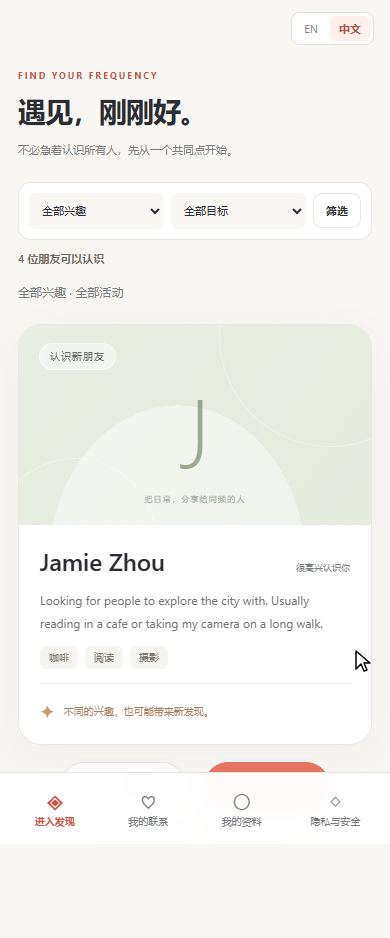

## Reduced motion: discovery

A real page capture under reduced-motion preference; submission behavior is checked in the script.

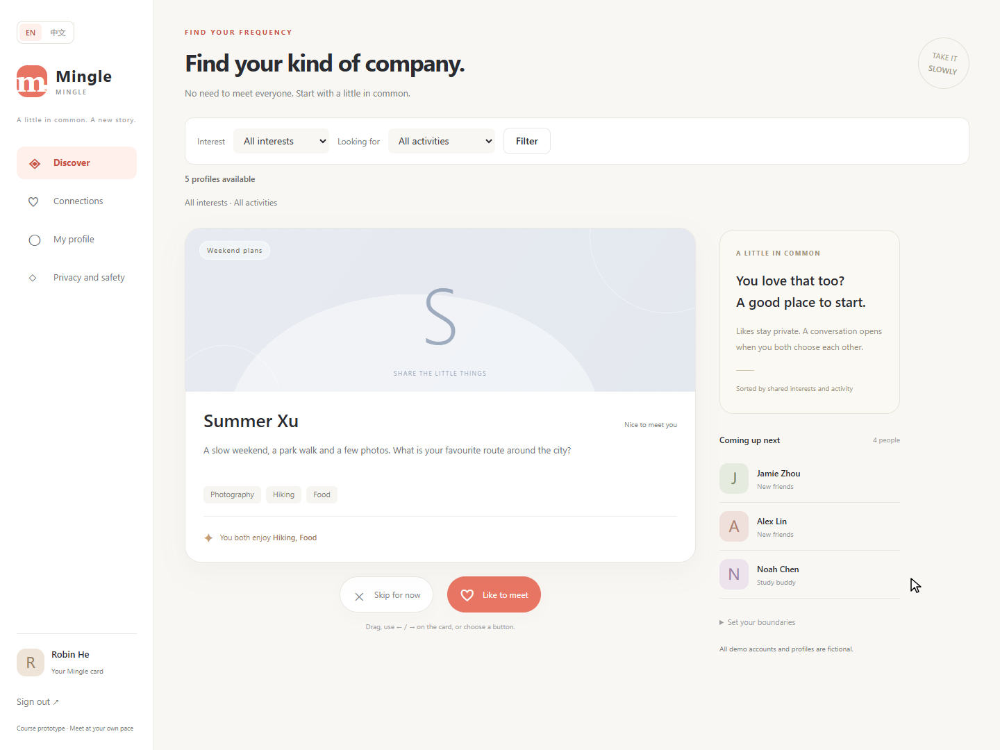

## Terminal screenshots — pending actual capture

The former images 13 and 14 were formatted HTML views of saved logs, not terminal screenshots. They have been removed from this evidence gallery and archive. Original Java/browser outputs remain supporting evidence.

Run the [live PowerShell workflow](./TERMINAL_EVIDENCE.md) from the full project and capture the real terminal at its pause points. Expected filenames: 01_java_terminal.png, 02_browser_terminal.png and 03_github_checks_terminal.png. No placeholder images are supplied, and no human capture is claimed.

## Trello: first increment ready for peer review

A is in Review; the other members retain their own work. This capture records actual board state and does not mark the full project complete. Native managed-browser JPEG retained without editing.

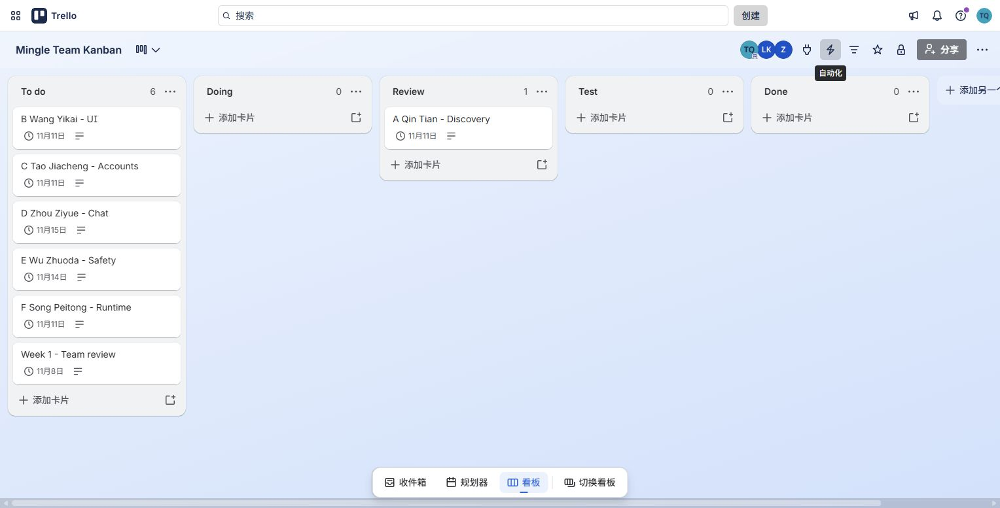

## GitHub: Ready for review and passing checks

PR #9 is open and not Draft. The captured implementation commit is e8cd17e; GitHub Java CI passed. The page also shows that no peer review had been submitted at capture time. Later delivery-only commits do not change the implementation pictured here.

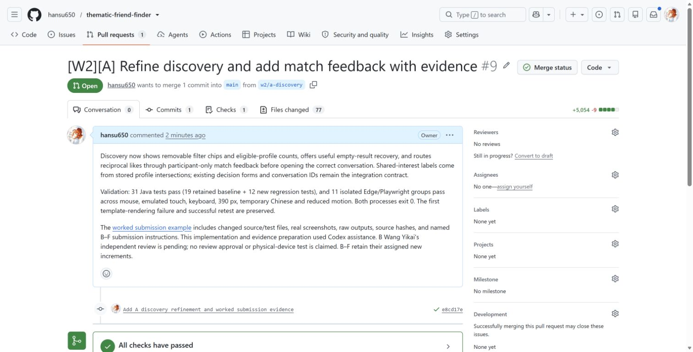

## Trello: implementation record and review boundary

The card links the PR and passing CI and explicitly leaves Wang Yikai's independent review pending.

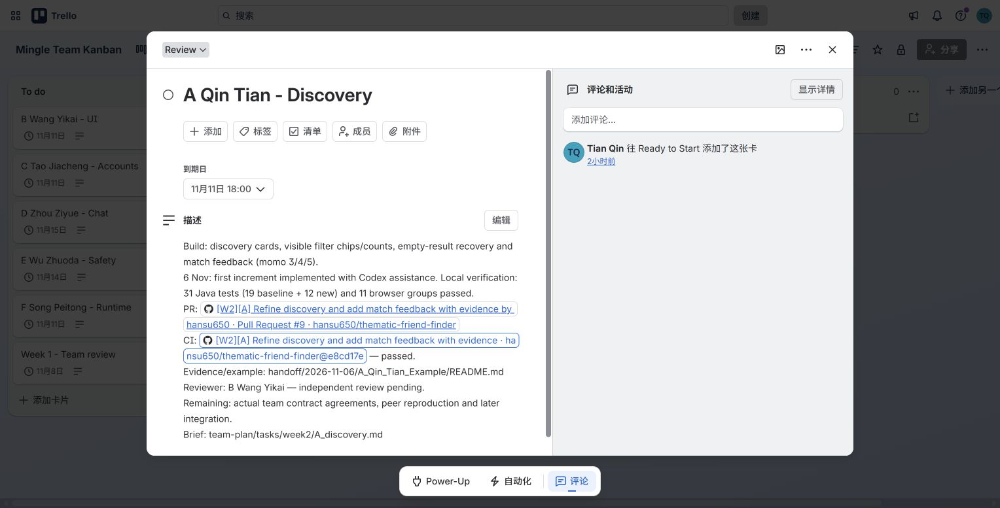
