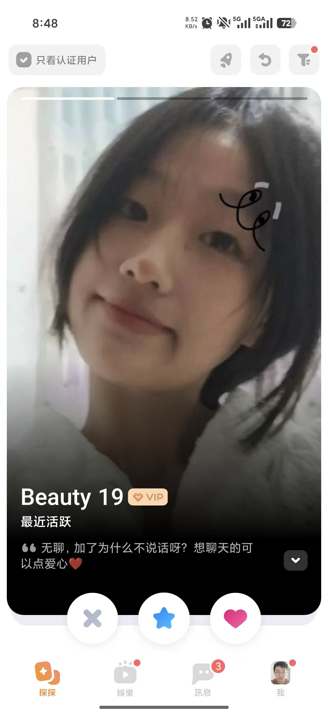
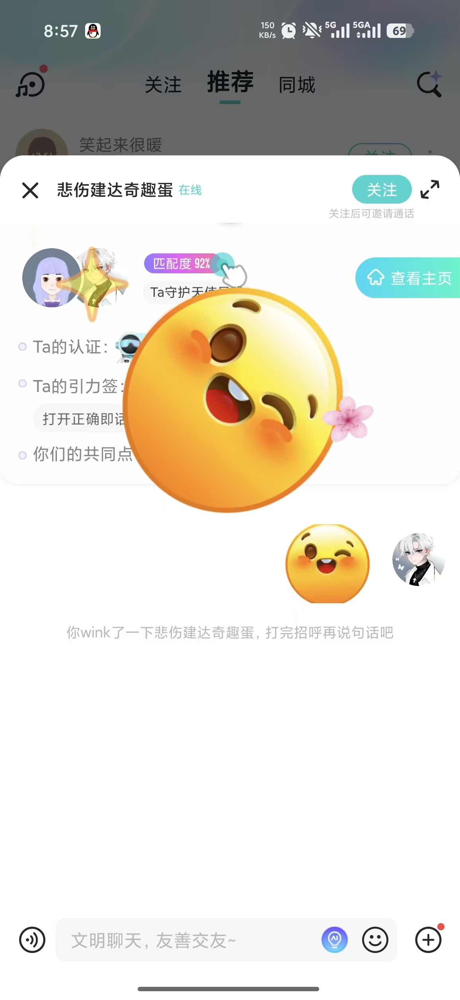
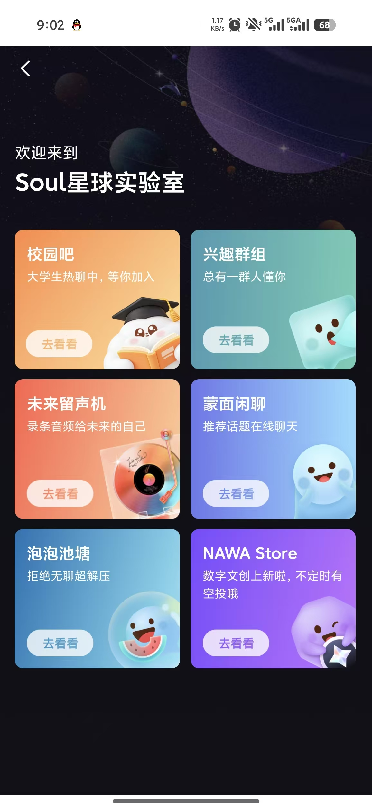

# B Wang Yikai: Live Profile Preview and Accessible UI

Owner: **Wang Yikai (B)** · Reviewer: **C Tao Jiacheng** · First feature target: **11 November 2026**. Internal dates are estimates. Use the merged baseline on current main, or this dated source snapshot; confirm shared contracts before overlapping edits.

[Run the project](./RUN.md) · [Six test scenarios](./TESTS.md) · [Team map](./TEAM.md) · [Photo and evidence plan](./EVIDENCE.md)

## What is already there

The profile form saves to H2 and displays a static preview of saved values. The included code is A's AI-assisted baseline. Your contribution is the increment below.

## Build this

1. Update the preview while nickname, bio, goal and interests are edited; do not save until the user submits the form.
2. Add a selected-interest counter and clear feedback for the five-interest maximum.
3. Use safe text insertion, visible keyboard focus and announced status feedback.
4. Check shared navigation, long text, both temporary languages, reduced motion, desktop and 390 px layouts.

**First small change:** Make the unsaved nickname and bio appear in the preview; verify refresh restores saved values.

Reference 9 supplies spacing and tile hierarchy only. Do not add its paid or social-room features. Coordinate shared CSS with A/D.

## Start in these files

All paths below are inside the included project.

- [src/main/resources/templates/profile.html](./code/thematic-friend/src/main/resources/templates/profile.html)
- [src/main/resources/templates/fragments/layout.html](./code/thematic-friend/src/main/resources/templates/fragments/layout.html)
- [src/main/resources/static/css/app.css](./code/thematic-friend/src/main/resources/static/css/app.css)
- [src/main/resources/messages.properties](./code/thematic-friend/src/main/resources/messages.properties)
- [src/main/resources/messages_zh.properties](./code/thematic-friend/src/main/resources/messages_zh.properties)

Suggested new files (not implemented yet):

- `src/main/resources/static/js/profile-preview.js`

## Tests and screenshots to submit

Implement the six distinct behavior groups in [TESTS.md](./TESTS.md). Include the first three relevant scenarios with your first feature PR; complete the six groups and independently reproduce two peer checks by **22 November**. Reuse existing checks openly and identify your new assertions.

| Capture | What to show | Example filename |
|---|---|---|
| Normal result | Unsaved preview reflecting edited fields | B_normal.png |
| Boundary/error | Sixth-interest selection feedback at 390 px | B_boundary.png |
| Executable test result | Readable test names/results, command and source version | B_tests.png |

Use fictional data. Capture desktop and 390 px where a UI assertion requires it. Record expected/actual results and any remaining limitation in your own progress MD.

## Hand in

Submit your changed source and tests, real output, normal/boundary screenshots, a PR/check capture, an updated personal Trello card and **B_progress.md**. Follow [SUBMIT.md](./SUBMIT.md) for branch **w2/b-interface**, [CAPTURE.md](./CAPTURE.md) for actual terminal commands and [FINISH_LINE.md](./FINISH_LINE.md) for final acceptance. The baseline was merged in PR #8; create a new task branch from current main, or continue your existing task branch without overwriting work.

Qin Tian has two code screenshots for explaining A's work. B–F do not need code screenshots; submit source/test files and a brief explanation in Markdown. Each member uses their own task package and captures.

## Your supplied UI references

These are the user's supplied reference screenshots, not screenshots of the implemented project. Some show Soul branding. Use layout/interaction ideas with the project's warm-white/coral style, English default and temporary language switch. Keep initials/gradients; profile photos remain deferred.

### Reference 4

Large discovery card, visible filters and decision buttons.

### Reference 7

Compact profile summary and readable context above chat.

### Reference 9

Consistent spacing and tile hierarchy; use only for existing destinations.

