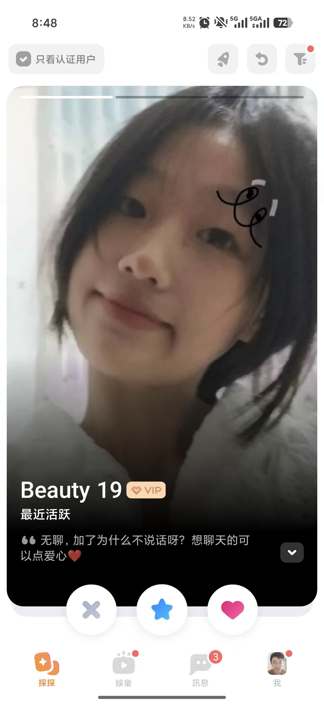
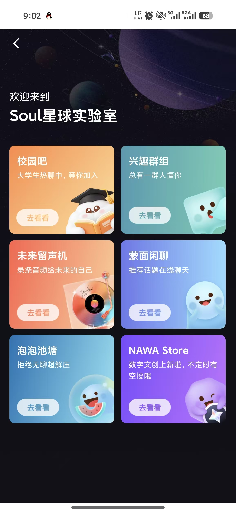

# C Tao Jiacheng: Password Change and Account Contracts

Owner: **Tao Jiacheng (C)** · Reviewer: **D Zhou Ziyue** · First feature target: **11 November 2026**. Internal dates are estimates. Use the merged baseline on current main, or this dated source snapshot; confirm shared contracts before overlapping edits.

[Run the project](./RUN.md) · [Six test scenarios](./TESTS.md) · [Team map](./TEAM.md) · [Photo and evidence plan](./EVIDENCE.md)

## What is already there

Registration, login, password hashing and own-profile editing exist. Password change is not implemented. The included code is A's AI-assisted baseline. Your contribution is the increment below.

## Build this

1. Add a signed-in change-password form requiring the current password, a new password and confirmation.
2. Reuse the configured password encoder and validate character length plus the bcrypt UTF-8 byte limit.
3. Agree and implement an explicit session policy after a successful change; record which sessions are invalidated.
4. Keep CSRF and current-user ownership checks. Agree account/role contracts with A/E before shared entity changes.

**First small change:** Add the validated form and service operation; prove wrong-current-password requests leave the stored credential unchanged.

No supplied image shows password settings. References 4/9 guide spacing and visual consistency only; design the account form for this project.

## Start in these files

All paths below are inside the included project.

- [src/main/java/com/example/thematicfriend/account/AccountController.java](./code/thematic-friend/src/main/java/com/example/thematicfriend/account/AccountController.java)
- [src/main/java/com/example/thematicfriend/account/AccountService.java](./code/thematic-friend/src/main/java/com/example/thematicfriend/account/AccountService.java)
- [src/main/java/com/example/thematicfriend/account/Member.java](./code/thematic-friend/src/main/java/com/example/thematicfriend/account/Member.java)
- [src/main/java/com/example/thematicfriend/config/SecurityConfig.java](./code/thematic-friend/src/main/java/com/example/thematicfriend/config/SecurityConfig.java)
- [src/main/resources/templates/profile.html](./code/thematic-friend/src/main/resources/templates/profile.html)

Suggested new files (not implemented yet):

- `src/main/resources/templates/change-password.html`

## Tests and screenshots to submit

Implement the six distinct behavior groups in [TESTS.md](./TESTS.md). Include the first three relevant scenarios with your first feature PR; complete the six groups and independently reproduce two peer checks by **22 November**. Reuse existing checks openly and identify your new assertions.

| Capture | What to show | Example filename |
|---|---|---|
| Normal result | Successful change feedback followed by login using the new credential | C_normal.png |
| Boundary/error | Wrong current password or invalid confirmation with a readable field error | C_boundary.png |
| Executable test result | Readable test names/results, command and source version | C_tests.png |

Use fictional data. Capture desktop and 390 px where a UI assertion requires it. Record expected/actual results and any remaining limitation in your own progress MD.

## Hand in

Submit your changed source and tests, real output, normal/boundary screenshots, a PR/check capture, an updated personal Trello card and **C_progress.md**. Follow [SUBMIT.md](./SUBMIT.md) for branch **w2/c-accounts**, [CAPTURE.md](./CAPTURE.md) for actual terminal commands and [FINISH_LINE.md](./FINISH_LINE.md) for final acceptance. The baseline was merged in PR #8; create a new task branch from current main, or continue your existing task branch without overwriting work.

Qin Tian has two code screenshots for explaining A's work. B–F do not need code screenshots; submit source/test files and a brief explanation in Markdown. Each member uses their own task package and captures.

## Your supplied UI references

These are the user's supplied reference screenshots, not screenshots of the implemented project. Some show Soul branding. Use layout/interaction ideas with the project's warm-white/coral style, English default and temporary language switch. Keep initials/gradients; profile photos remain deferred.

### Reference 4

Large discovery card, visible filters and decision buttons.

### Reference 9

Consistent spacing and tile hierarchy; use only for existing destinations.

