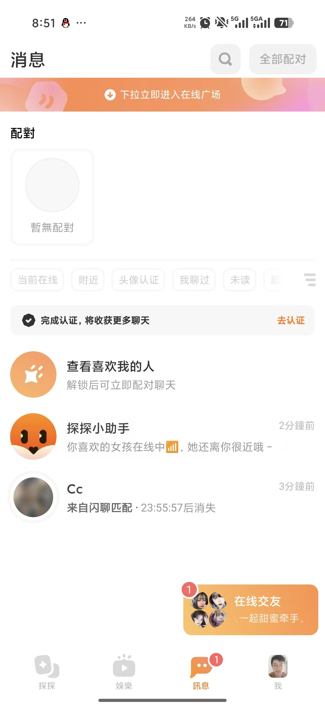
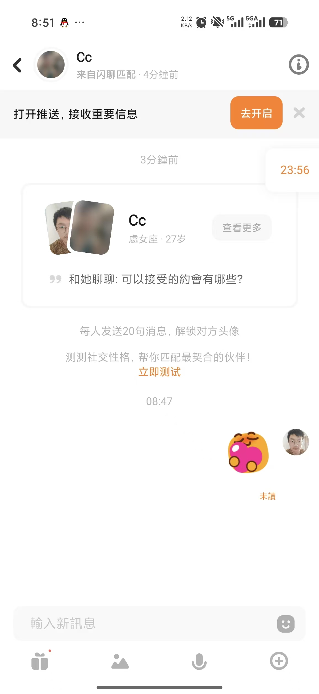
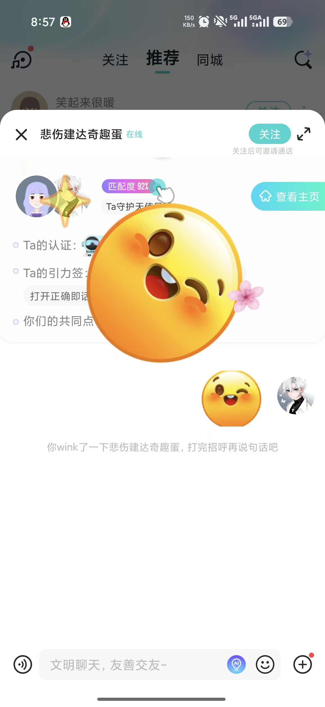
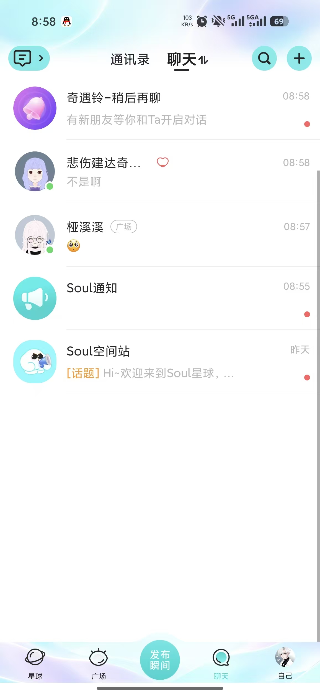

# D Zhou Ziyue: Unread Messages and Older Chat History

Owner: **Zhou Ziyue (D)** · Reviewer: **E Wu Zhuoda** · First feature target: **15 November 2026**. Internal dates are estimates. Use the merged baseline on current main, or this dated source snapshot; confirm shared contracts before overlapping edits.

[Run the project](./RUN.md) · [Six test scenarios](./TESTS.md) · [Team map](./TEAM.md) · [Photo and evidence plan](./EVIDENCE.md)

## What is already there

Mutual connections, text messages, participant checks and polling exist. Initially only the latest 100 messages are shown; there are no unread markers or older-history controls. The included code is A's AI-assisted baseline. Your contribution is the increment below.

## Build this

1. Add per-participant read state and an unread indicator in the conversation list.
2. Add bounded older-message paging with stable ID-based ordering.
3. Merge older pages and new polling results without duplicates, gaps or reordered messages.
4. Enforce participant, active-connection and block rules for history and read-state endpoints; use CSRF-protected POST for state changes.

**First small change:** Agree the read marker and cursor contract with A/C; build a two-session unread-count test.

You can inspect templates and prepare fixtures now. Integrate against the agreed T03/T04 contracts before changing shared data.

## Start in these files

All paths below are inside the included project.

- [src/main/java/com/example/thematicfriend/chat/ChatController.java](./code/thematic-friend/src/main/java/com/example/thematicfriend/chat/ChatController.java)
- [src/main/java/com/example/thematicfriend/chat/ChatService.java](./code/thematic-friend/src/main/java/com/example/thematicfriend/chat/ChatService.java)
- [src/main/java/com/example/thematicfriend/chat/MessageRepository.java](./code/thematic-friend/src/main/java/com/example/thematicfriend/chat/MessageRepository.java)
- [src/main/java/com/example/thematicfriend/connection/Connection.java](./code/thematic-friend/src/main/java/com/example/thematicfriend/connection/Connection.java)
- [src/main/resources/templates/connections.html](./code/thematic-friend/src/main/resources/templates/connections.html)
- [src/main/resources/templates/conversation.html](./code/thematic-friend/src/main/resources/templates/conversation.html)
- [src/main/resources/static/js/chat.js](./code/thematic-friend/src/main/resources/static/js/chat.js)

## Tests and screenshots to submit

Implement the six distinct behavior groups in [TESTS.md](./TESTS.md). Include the first three relevant scenarios with your first feature PR; complete the six groups and independently reproduce two peer checks by **22 November**. Reuse existing checks openly and identify your new assertions.

| Capture | What to show | Example filename |
|---|---|---|
| Normal result | Incoming unread badge, then the conversation after acknowledgement | D_normal.png |
| Boundary/error | Older page beyond 100 messages or an access-denied conversation | D_boundary.png |
| Executable test result | Readable test names/results, command and source version | D_tests.png |

Use fictional data. Capture desktop and 390 px where a UI assertion requires it. Record expected/actual results and any remaining limitation in your own progress MD.

## Hand in

Submit your changed source and tests, real output, normal/boundary screenshots, a PR/check capture, an updated personal Trello card and **D_progress.md**. Follow [SUBMIT.md](./SUBMIT.md) for branch **w2/d-connections**, [CAPTURE.md](./CAPTURE.md) for actual terminal commands and [FINISH_LINE.md](./FINISH_LINE.md) for final acceptance. The baseline was merged in PR #8; create a new task branch from current main, or continue your existing task branch without overwriting work.

Qin Tian has two code screenshots for explaining A's work. B–F do not need code screenshots; submit source/test files and a brief explanation in Markdown. Each member uses their own task package and captures.

## Your supplied UI references

These are the user's supplied reference screenshots, not screenshots of the implemented project. Some show Soul branding. Use layout/interaction ideas with the project's warm-white/coral style, English default and temporary language switch. Keep initials/gradients; profile photos remain deferred.

### Reference 1

Conversation list and unread-state hierarchy.

### Reference 2

Conversation header, context and text composer.

### Reference 7

Compact profile summary and readable context above chat.

### Reference 8

Message preview, time and unread marker.

