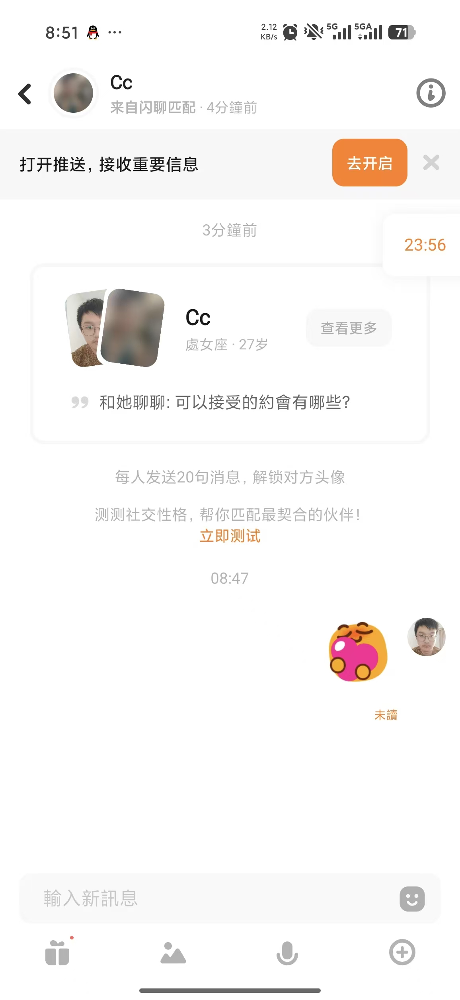
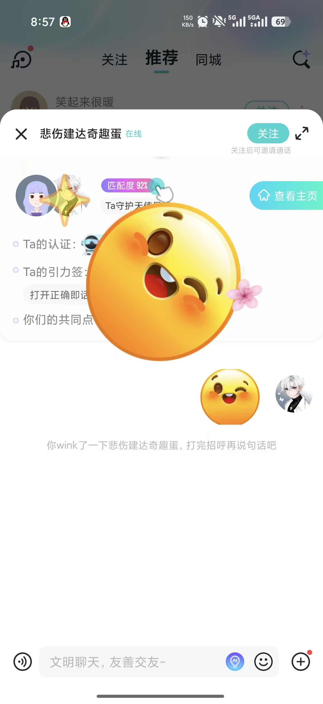

# E Wu Zhuoda: Restricted Report Review and Permission Tests

Owner: **Wu Zhuoda (E)** · Reviewer: **F Song Peitong** · First feature target: **14 November 2026**. Internal dates are estimates. Start from the included source now; confirm shared contracts before integration.

[Run the project](./RUN.md) · [Six test scenarios](./TESTS.md) · [Team map](./TEAM.md) · [Photo and evidence plan](./EVIDENCE.md)

## What is already there

Blocking, report submission and private report receipts exist. There is no staff role or report-review queue. The included code is A's AI-assisted baseline. Your contribution is the increment below.

## Build this

1. Add a staff-only report list/detail page and a minimal allowed status-update workflow.
2. Record the authorised handler and time; keep internal notes private.
3. Agree a controlled staff-account setup with A/C. Ordinary signup must not grant staff access.
4. Test page and endpoint permissions for anonymous, ordinary and staff users; keep POST/CSRF protection.

**First small change:** Agree the role contract, create permission fixtures, and prove ordinary users cannot access the planned review route.

References 2/7 guide safety entry placement. The staff review page is a new design. This is a local course workflow, not a live moderation service.

## Start in these files

All paths below are inside the included project.

- [src/main/java/com/example/thematicfriend/safety/SafetyController.java](./code/thematic-friend/src/main/java/com/example/thematicfriend/safety/SafetyController.java)
- [src/main/java/com/example/thematicfriend/safety/SafetyService.java](./code/thematic-friend/src/main/java/com/example/thematicfriend/safety/SafetyService.java)
- [src/main/java/com/example/thematicfriend/safety/Report.java](./code/thematic-friend/src/main/java/com/example/thematicfriend/safety/Report.java)
- [src/main/java/com/example/thematicfriend/safety/ReportRepository.java](./code/thematic-friend/src/main/java/com/example/thematicfriend/safety/ReportRepository.java)
- [src/main/java/com/example/thematicfriend/config/SecurityConfig.java](./code/thematic-friend/src/main/java/com/example/thematicfriend/config/SecurityConfig.java)
- [src/main/resources/templates/safety.html](./code/thematic-friend/src/main/resources/templates/safety.html)

Suggested new files (not implemented yet):

- `src/main/resources/templates/report-review.html`

## Tests and screenshots to submit

Implement the six distinct behavior groups in [TESTS.md](./TESTS.md). Include the first three relevant scenarios with your first feature PR; complete the six groups and independently reproduce two peer checks by **22 November**. Reuse existing checks openly and identify your new assertions.

| Capture | What to show | Example filename |
|---|---|---|
| Normal result | Staff review queue and a saved valid status change | E_normal.png |
| Boundary/error | Ordinary-user rejection and reporter-only receipt visibility | E_boundary.png |
| Executable test result | Readable test names/results, command and source version | E_tests.png |

Use fictional data. Capture desktop and 390 px where a UI assertion requires it. Record expected/actual results and any remaining limitation in your own progress MD.

## Hand in

Submit changed source, test source, test output, three purposeful captures and **E_progress.md**. A reviews and merges; A's own work receives peer review. After A publishes the Java baseline, use branch **w2/e-safety** from the current main, not the historical research branch. Until then, develop in this extracted copy and retain an exact list of changed files for A to apply to that baseline. Do not include caches, target output or a runtime database in your submission.

## Your supplied UI references

These are the user's supplied reference screenshots, not screenshots of the implemented project. Some show Soul branding. Use layout/interaction ideas with the project's warm-white/coral style, English default and temporary language switch. Keep initials/gradients; profile photos remain deferred.

### Reference 2

Conversation header, context and text composer.

### Reference 7

Compact profile summary and readable context above chat.

