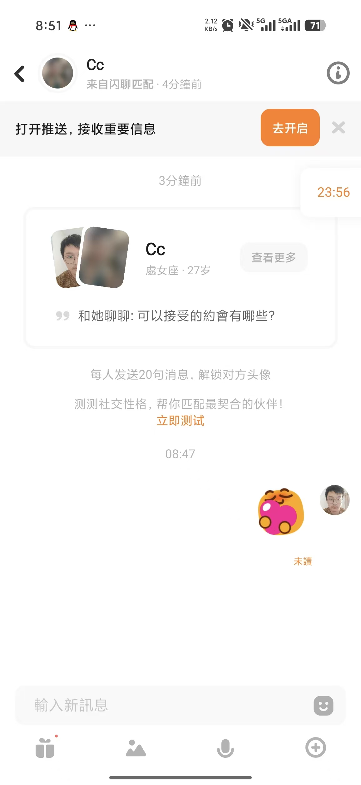
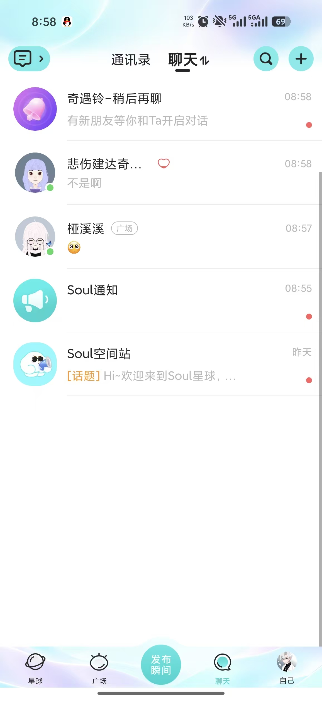

# F Song Peitong: Backup, Restore and Clean-Copy Reproduction

Owner: **Song Peitong (F)** · Reviewer: **A Qin Tian** · First feature target: **11 November 2026**. Internal dates are estimates. Use the merged baseline on current main, or this dated source snapshot; confirm shared contracts before overlapping edits.

[Run the project](./RUN.md) · [Six test scenarios](./TESTS.md) · [Team map](./TEAM.md) · [Photo and evidence plan](./EVIDENCE.md)

## What is already there

Maven Wrapper, build/run helpers, file H2 and optional fictional demo users exist. Backup/restore tooling is not implemented. The included code is A's AI-assisted baseline. Your contribution is the increment below.

## Build this

1. Implement a stopped-database backup with a timestamped destination, manifest and checksum.
2. Implement validation and restore into a fresh isolated destination; refuse unsafe paths, corrupt input and accidental overwrites.
3. Improve actionable startup/backup errors and document exact commands for Java 21 and Maven Wrapper.
4. Verify fixture data survives restart/restore, then ask another member to reproduce selected A–E checks.

**First small change:** Build this clean source package, record the command/environment, then create the backup manifest/checksum path on disposable fixtures.

These images identify existing screens to reproduce; they do not add a UI implementation assignment. Your contribution is runtime tools, executable failure-path checks and independent reproduction.

## Start in these files

All paths below are inside the included project.

- [scripts/build.ps1](./code/thematic-friend/scripts/build.ps1)
- [scripts/run-demo.ps1](./code/thematic-friend/scripts/run-demo.ps1)
- [src/main/resources/application.properties](./code/thematic-friend/src/main/resources/application.properties)
- [README.md](./code/thematic-friend/README.md)

Suggested new files (not implemented yet):

- `scripts/backup.ps1`
- `scripts/restore.ps1`
- `scripts/tests/BackupRestore.Tests.ps1`

## Tests and screenshots to submit

Implement the six distinct behavior groups in [TESTS.md](./TESTS.md). Include the first three relevant scenarios with your first feature PR; complete the six groups and independently reproduce two peer checks by **22 November**. Reuse existing checks openly and identify your new assertions.

| Capture | What to show | Example filename |
|---|---|---|
| Normal result | Backup/restore command output and recovered fictional connection/message | F_normal.png |
| Boundary/error | Corrupt backup or occupied destination rejected without overwriting data | F_boundary.png |
| Executable test result | Readable test names/results, command and source version | F_tests.png |

Use fictional data. Capture desktop and 390 px where a UI assertion requires it. Terminal/process outputs count as relevant runtime evidence; pair them with the recovered fixture screen. Record expected/actual results and any remaining limitation in your own progress MD.

## Hand in

Submit your changed source and tests, real output, normal/boundary screenshots, a PR/check capture, an updated personal Trello card and **F_progress.md**. Follow [SUBMIT.md](./SUBMIT.md) for branch **w2/f-runtime**, [CAPTURE.md](./CAPTURE.md) for actual terminal commands and [FINISH_LINE.md](./FINISH_LINE.md) for final acceptance. The baseline was merged in PR #8; create a new task branch from current main, or continue your existing task branch without overwriting work.

Qin Tian has two code screenshots for explaining A's work. B–F do not need code screenshots; submit source/test files and a brief explanation in Markdown. Each member uses their own task package and captures.

## Your supplied UI references

These are the user's supplied reference screenshots, not screenshots of the implemented project. Some show Soul branding. Use layout/interaction ideas with the project's warm-white/coral style, English default and temporary language switch. Keep initials/gradients; profile photos remain deferred.

### Reference 2

Conversation header, context and text composer.

### Reference 4

Large discovery card, visible filters and decision buttons.

### Reference 8

Message preview, time and unread marker.

