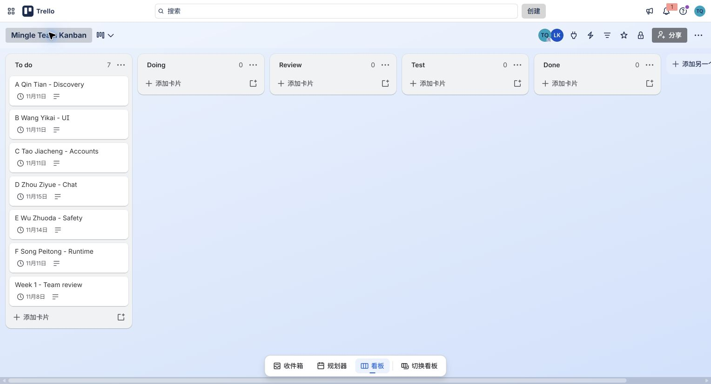

# Trello and Kanban Working Rules

Live private board: [Mingle Team Kanban](https://trello.com/b/j4LiifAK), created on 6 November 2026. Tasks use the confirmed A–F names. The current board has five lists and seven cards: six named member tasks and one weekly review. The named MD/ZIP packages are the implementation handoff; Trello records actual progress and readable weekly evidence.

The Product Backlog orders possible work. Sprint Planning selects a goal and a feasible subset. Trello shows actual task state, Excel shows dates/dependencies and Draw.io explains the critical paths. Use the same IDs across these artifacts.

Role update, 13 November: C is Product Owner and maintains backlog priorities and acceptance criteria. A is Scrum Master and Lead Developer, facilitating planning, blocker follow-up and retrospectives while leading technical integration. Each member updates their own cards. E coordinates regression results and defect/retest evidence as Test Coordinator.

| List | Entry / exit policy | Initial WIP limit |
|---|---|---|
| To do | Current assigned work with an owner, task brief and prerequisites | Keep the current board compact |
| Doing | Actually started; leave when ready for another person to inspect | 6 team-wide; 1 main task per person |
| Review | PR or readable artifact and self-check supplied; leave when comments addressed | 2 |
| Test | Reproducible check available; leave when acceptance and evidence complete | 2 |
| Done | Merged/delivered and the completion standard is met | No fixed cap |

Blocked work stays in its current list, counts towards WIP and has a Blocked label, reason, responsible helper and next check time. When Review is full, help review before pulling more work. Adjust limits after observing a real bottleneck.

## Initial work packages

Keep the 16 work packages, six detailed test briefs and five weekly evidence plans in Markdown and Excel. Current cards are A Qin Tian - Discovery, B Wang Yikai - UI, C Tao Jiacheng - Accounts, D Zhou Ziyue - Chat, E Wu Zhuoda - Safety, F Song Peitong - Runtime, and Week 1 - Team review. The original guide/backlog and detailed task cards were archived when the user requested a shorter board. Retrieve them only when useful. Do not create a visible card for every test scenario.

## Copyable card description

```markdown
Build: one clear feature goal
Task: named MD or PR link
Test: key assertions; full scenarios in TESTS.md
Evidence: normal, boundary and test-result captures
Review: named reviewer and next action
```

Use Research, UI, Backend, Testing, Evidence and Blocked labels plus W1/S1/S2. Assign the owner with card Members and the target with card Date. Advanced paid fields are unnecessary. Trello supports common Markdown; turn work packages into cards rather than expecting a Markdown table to become a board. [Formatting guide](https://support.atlassian.com/trello/docs/how-to-format-your-text-in-trello/).

Keep states current and retain actual review and carry-over reasons at Sprint end. A planning screenshot alone is not evidence that the work happened.

Test work is included in each feature's budget, not extra hours added to the Gantt totals. Never move the weekly review to Done before the real discussion and evidence exist. Capture one full-board screenshot after the actual weekly update.



The seven cards were still in To do in this capture. This is the browser tool's native JPEG. The seven user-supplied first-day originals are now indexed in the local `photo/A_progress.md` category archive, retaining their 6 November date and original bytes.
