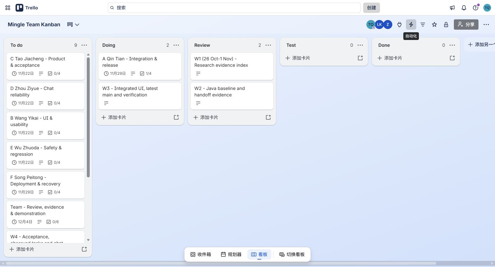
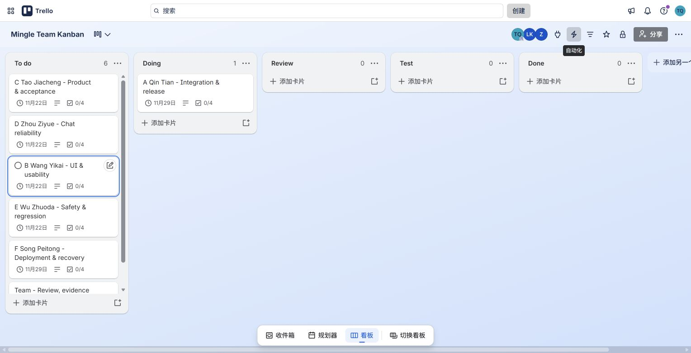

# Trello and Kanban Working Rules

Updated and visually checked in the signed-in Edge browser on 14 November 2026.

Use [Mingle Team Kanban](https://trello.com/b/j4LiifAK/mingle-team-kanban) for daily work. GitHub holds code, PRs and versioned test evidence. Keep fuller meeting, test and reflection records in Markdown and link them from the relevant card. The XLSX remains an optional template; it is not the daily management entry point.

The private board retains its five lists and seven existing member/team cards, their original identities and activity history. Six weekly index cards were added on 14 November. The board now has 13 cards: nine in To do, two in Doing and two in Review. Test and Done are empty. Merged implementation is recorded separately from remaining acceptance work.

## Current cards

| Card | State at this update | Internal target | Open checklist items |
|---|---|---|---:|
| [A Qin Tian - Integration & release](https://trello.com/c/YQhFPGKX) | Doing: source sync and automated checks recorded; independent acceptance/release pending | 29 Nov, 18:00 | 3 |
| [C Tao Jiacheng - Product & acceptance](https://trello.com/c/G5E6r3x0) | To do: remaining acceptance work | 22 Nov, 18:00 | 4 |
| [D Zhou Ziyue - Chat reliability](https://trello.com/c/03lTfNYQ) | To do: reliability extension and verification | 22 Nov, 18:00 | 4 |
| [B Wang Yikai - UI & usability](https://trello.com/c/8MZHEL1I) | To do: final UI checks, observation and independent review | 22 Nov, 18:00 | 4 |
| [E Wu Zhuoda - Safety & regression](https://trello.com/c/x3d0dlGM) | To do: permissions, defects and retests | 22 Nov, 18:00 | 4 |
| [F Song Peitong - Deployment & recovery](https://trello.com/c/ZwaQh6f0) | To do: reproduction and operational handover | 29 Nov, 18:00 | 4 |
| [Team - Review, evidence & demonstration](https://trello.com/c/xNMh9Pqi) | To do: actual sessions, evidence and assessment completion | 4 Dec, 18:00 | 6 |

Dates above are internal targets as displayed in the signed-in browser, not the university deadline. No reminder subscription was added. The Moodle evidence shows 18 December 2026 at 13:00, without a visible timezone. The [six-week plan](./16_six_week_evidence_plan.md) explains the calendar and scope.

Each member/team card includes its named owner, relevant reviewer, merged PR evidence, next actions and completion criteria. Names in titles/descriptions identify responsibility; no new member invitation or account assignment was made. The To do order is C, D, B, E, F, Team, W4, W5, W6. A's source-sync item is checked because it occurred, leaving three of its four items open. The other 26 acceptance/evidence items remain open.

## Six weekly indexes

| Teaching week | Card | State and evidence boundary |
|---|---|---|
| W1, 26 Oct–1 Nov | [Research evidence index](https://trello.com/c/SmJE3MWh) | Review. Reconstructed index of dated source/research records; it does not claim a contemporaneous meeting. |
| W2, 2–8 Nov | [Java baseline and handoff evidence](https://trello.com/c/HGDOHNsN) | Review. PRs, named packages and original 6 November captures are linked for historical checking. |
| W3, 9–15 Nov | [Integrated UI, latest main and verification](https://trello.com/c/quumcm4M) | Doing. Includes main `7764f0e`, actual 14 November automated results, local fixes and open limits. |
| W4, 16–22 Nov | [Acceptance, observed tasks and chat reliability](https://trello.com/c/B32dVzpG) | To do. Planned work with owners, outputs and completion conditions. |
| W5, 23–29 Nov | [Selected fixes, feature freeze and handover](https://trello.com/c/sXcZsqKD) | To do. Planned feedback fixes, 26 November freeze and independent reproduction. |
| W6, 30 Nov–6 Dec | [Evaluation, demonstration and individual reflections](https://trello.com/c/KPeqA8Nc) | To do. Planned evaluation, demonstration and personal writing; internal finish 4 December. |

The weekly cards are indexes for the same board. They do not replace each member's work card or create a second management system. The new cards and descriptions were written on 14 November; their activity dates were not backdated. No future work was marked done.

## Work flow

| List | Entry / exit policy | Initial WIP limit |
|---|---|---|
| To do | Assigned remaining work with an owner and acceptance criteria | Keep the board compact |
| Doing | Actually started; leave when ready for another person to inspect | One main card per person |
| Review | PR or readable artifact and self-check supplied; leave when comments are addressed | 2 |
| Test | Reproducible check available; leave when acceptance and evidence are complete | 2 |
| Done | Accepted output with its actual result and evidence linked | No fixed cap |

Blocked work stays in its current list and counts towards WIP. State the reason, responsible helper and next check time. Help review or test before starting more work when those columns are full.

C maintains product priorities and acceptance criteria. A facilitates real planning, blocker follow-up and retrospectives while leading technical integration. E coordinates defects and retests. Each owner records actual progress; each person retains their own reflection and authorship.

## What to attach

- For implementation: a permanent PR/commit link and the tested revision.
- For tests: expected/actual result, tester/date, environment, full log, exit status and a useful capture.
- For decisions: alternatives, reason, owner, next date and later outcome, using the [meeting template](./meetings/session_record_template.md).
- For observations: anonymous participant code, task, actual difficulty, selected improvement and retest.

Keep detailed scenarios in the task/test records rather than creating a card for every assertion. The six named 6 November packages and old branch names remain historical handoff material. Of the 30 member/team checklist items, one source-sync item is now completed and 29 remain open. The automated results were actually executed by Codex as documented in the [local verification report](../code/thematic-friend/docs/releases/2026-11-14-main-verification.md). This board update does not claim a real meeting, attendance, independent review, product acceptance or deployment.

## Board evidence

Original browser JPEG captured after the six weekly indexes and actual verification update. It shows A/W3 in Doing, W1/W2 in Review and the remaining work in To do. W4–W6 continue lower down that scrollable list. A's checklist visibly reads 1/4. The native board links and card descriptions were inspected before capture.

Earlier 14 November capture before the six weekly cards were added. It is retained as history. This is a planning/status capture, not evidence of completed meetings or final acceptance.

The earlier capture retains its original date. It shows the seven early cards in To do and is not the current board state.
